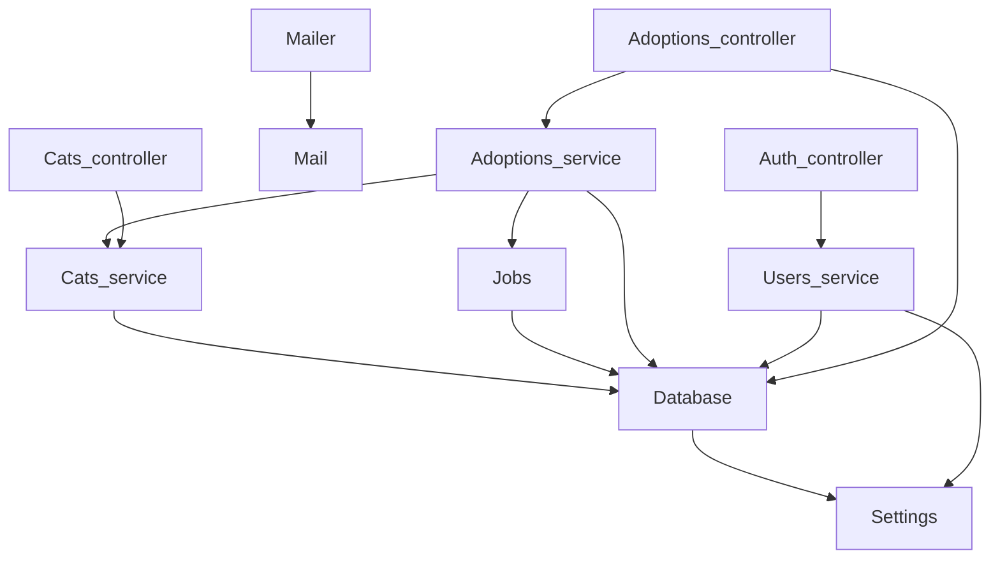

# Actuator and health checks

`Kre.Actuator.make` builds a controller under `/actuator` and a metrics middleware.

| Path | What |
| --- | --- |
| `/actuator/health` | all checks; 200 `up` or 503 `down` with the reason |
| `/actuator/info` | the `~info` pairs (version, commit) |
| `/actuator/env` | config through `Config.pairs`: `[@secret]` → `***` |
| `/actuator/routes` | `spec` of all controllers |
| `/actuator/openapi.json` | OpenAPI 3.1 |
| `/actuator/metrics` | Prometheus: requests by method and status, time, GC |
| `/actuator/beans` | the application graph from `[%wire]`: providers in start order, then controllers, each with what it received |
| `/actuator/beans.mmd` | the same graph in mermaid |

The graph is built at compile time: `[%wire]` puts it into `app.beans`, so it matches what is actually applied. The graph of `examples/shelter`:



A health check is a provider function `unit -> (unit, string) result Lwt.t` with `[@@health "db"]`; `[%wire]` collects them into `app.health`. By default the actuator answers only on loopback (`~access:Anyone` answers everyone).

<!-- $MDX file=../examples/cats/bin/main.ml -->
```ocaml
let () =
  let app = [%wire] in
  let actuator =
    Kre.Actuator.make ~checks:app.health ~beans:app.beans
      ~env:(Config.pairs Settings.config)
      app.controllers
  in
  Kre.App.run ~port:Settings.config.port
    ~middleware:
      [ Dream.logger; actuator.metrics; Web.use ~dir:Settings.config.web ]
    ~on_start:app.on_start ~on_shutdown:app.on_shutdown
    (actuator.controller :: Kre.Live.controller :: app.controllers)
```

<!-- $MDX file=../examples/cats/db/database.ml -->
```ocaml
module Make (Settings : Settings.S) = struct
  include
    Kre.Db.Make
      (Kre_db_mariadb.Driver)
      (struct
        let url = Settings.database_url
        let size = 4
      end)

  let on_start () =
    with_conn (fun conn ->
        Lwt.map ignore
          (Kre.Migration.up
             (module Kre_db_mariadb.Driver)
             conn
             (Result.get_ok (Kre.Migration.of_files [%embed_dir "migrations"]))))

  let ping () =
    Lwt.catch
      (fun () ->
        with_conn (fun conn ->
            Lwt.map
              (fun _ -> Ok ())
              (Kre_db_mariadb.Driver.strings conn "SELECT 1")))
      (fun exn -> Lwt.return_error (Printexc.to_string exn))
  [@@health "db"]
end
```
