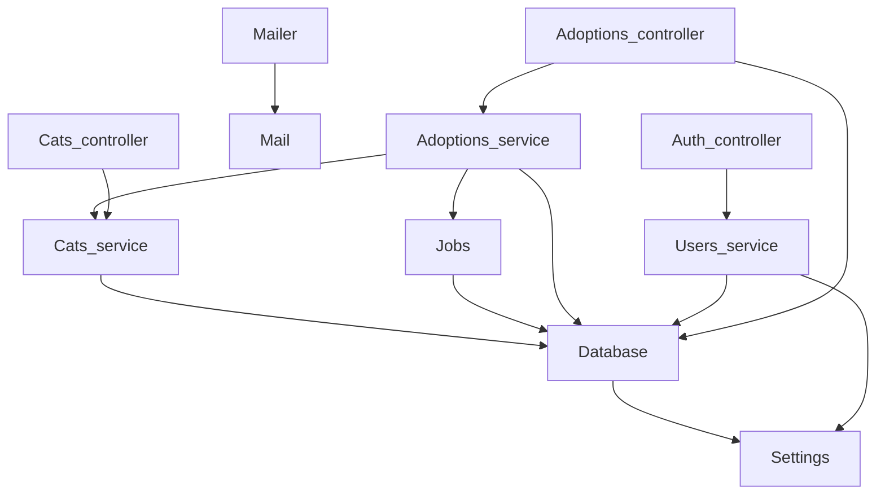

# Actuator и health checks

Spring: Actuator (`/health`, `/info`, `/env`, `/metrics`). Nest: Terminus. Forge: `Forge.Actuator.make` — контроллер под `/actuator` и middleware метрик.

| Путь | Что |
| --- | --- |
| `/actuator/health` | все проверки; 200 `up` или 503 `down` с причиной |
| `/actuator/info` | пары `~info` (версия, коммит) |
| `/actuator/env` | конфиг через `Config.pairs`: `[@secret]` — `***` |
| `/actuator/routes` | `spec` всех контроллеров |
| `/actuator/openapi.json` | OpenAPI 3.1 |
| `/actuator/metrics` | Prometheus: запросы по методу и статусу, время, GC |
| `/actuator/beans` | граф приложения из `[%wire]`: провайдеры в порядке запуска, затем контроллеры, у каждого — что он получил |
| `/actuator/beans.mmd` | тот же граф в mermaid |

Граф — как `/actuator/beans` в Spring и граф модулей в Nest Devtools, только собран при компиляции: `[%wire]` кладёт его в `app.beans`, и он совпадает с тем, что реально применено. Граф `examples/shelter`:



Проверка здоровья — функция провайдера `unit -> (unit, string) result Lwt.t` с `[@@health "db"]`; `[%wire]` собирает их в `app.health`. По умолчанию actuator отвечает только с loopback (`~access:Anyone` — всем).

<!-- $MDX file=../examples/cats/bin/main.ml -->
```ocaml
let () =
  let app = [%wire] in
  let actuator =
    Forge.Actuator.make ~checks:app.health ~beans:app.beans
      ~env:(Config.pairs Settings.config)
      app.controllers
  in
  Forge.App.run ~port:Settings.config.port
    ~middleware:
      [ Dream.logger; actuator.metrics; Web.use ~dir:Settings.config.web ]
    ~on_start:app.on_start ~on_shutdown:app.on_shutdown
    (actuator.controller :: Forge.Live.controller :: app.controllers)
```

<!-- $MDX file=../examples/cats/db/database.ml -->
```ocaml
module Make (Settings : Settings.S) = struct
  include
    Forge.Db.Make
      (Forge_db_mariadb.Driver)
      (struct
        let url = Settings.database_url
        let size = 4
      end)

  let on_start () =
    with_conn (fun conn ->
        Lwt.map ignore
          (Forge.Migration.up
             (module Forge_db_mariadb.Driver)
             conn
             (Result.get_ok
                (Forge.Migration.of_files [%embed_dir "migrations"]))))

  let ping () =
    Lwt.catch
      (fun () ->
        with_conn (fun conn ->
            Lwt.map
              (fun _ -> Ok ())
              (Forge_db_mariadb.Driver.strings conn "SELECT 1")))
      (fun exn -> Lwt.return_error (Printexc.to_string exn))
  [@@health "db"]
end
```
