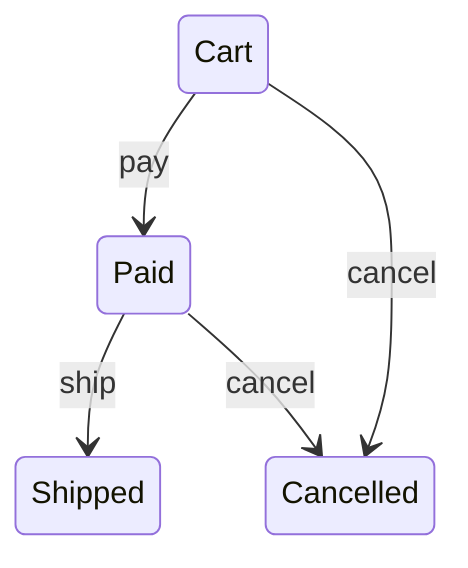

# Workflow

Symfony: компонент Workflow. Rails: AASM. Spring: Statemachine. Во всех трёх состояния и переходы описываются строками в конфиге или DSL, а ошибки находит рантайм. В Kre состояния — вариант, переходы — обычные `function` по этим конструкторам:

<!-- $MDX file=examples/order.ml -->
```ocaml
type t = Cart | Paid | Shipped | Cancelled
[@@deriving dto, workflow]
[@@transitions
  {
    pay = (function Cart -> Paid);
    ship = (function Paid -> Shipped);
    cancel = (function Cart | Paid -> Cancelled);
  }]
```

`[@@deriving workflow]` генерирует:

- `type transition = Pay | Ship | Cancel`, `transitions`, `transition_name`;
- `next : transition -> t -> t option` и `apply : transition -> t -> (t, [> `Not_allowed of transition * t ]) result`. Запрещённый переход — значение ошибки, сервис превращает его в 409;
- `allowed state` — какие переходы доступны (кнопки на странице);
- `sources transition` — из каких состояний переход возможен, для атомарного `UPDATE … WHERE status IN (…)`;
- `workflow_mermaid` — диаграмма `stateDiagram-v2` для документации.

Ветки — настоящие образцы: опечатка в состоянии (`Payd`) — ошибка компиляции, `function Cart | Paid -> Cancelled` — переход из двух состояний, `_ ->` — из любого. Условий (`when`) нет: переход решается состояниями, а проверки прав и данных живут в сервисе. С `[@@deriving dto]` тот же тип — строка в JSON и столбец таблицы; деривер работает и в Melange, так что клиент показывает те же `allowed`.


