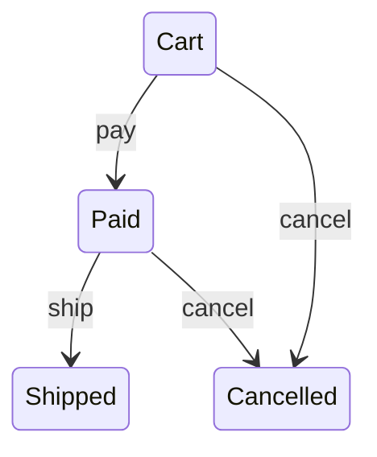

# Workflow

In Kre the states of a workflow are a variant, and transitions are plain `function`s over its constructors, so the compiler, not the runtime, finds the errors:

<!-- $MDX file=examples/order.ml -->
```ocaml
type t = Cart | Paid | Shipped | Cancelled
[@@deriving dto, workflow]
[@@transitions
  {
    pay = (function Cart -> Paid);
    ship = (function Paid -> Shipped);
    cancel = (function Cart | Paid -> Cancelled);
  }]
```

`[@@deriving workflow]` generates:

- `type transition = Pay | Ship | Cancel`, `transitions`, `transition_name`;
- `next : transition -> t -> t option` and `apply : transition -> t -> (t, [> `Not_allowed of transition * t ]) result`. A forbidden transition is an error value; the service turns it into a 409;
- `allowed state`: which transitions are available (buttons on the page);
- `sources transition`: from which states the transition is possible, for an atomic `UPDATE … WHERE status IN (…)`;
- `workflow_mermaid`: a `stateDiagram-v2` diagram for documentation.

Branches are real patterns: a typo in a state (`Payd`) is a compile error, `function Cart | Paid -> Cancelled` is a transition from two states, `_ ->` is from any state. There are no conditions (`when`): a transition is decided by states, and permission and data checks live in the service. With `[@@deriving dto]` the same type is a string in JSON and a table column; the deriver also works in Melange, so the client shows the same `allowed`.


