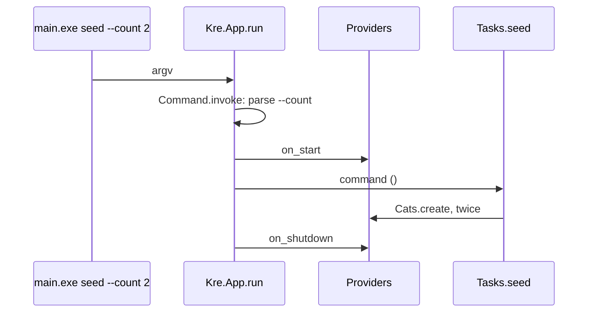

<script setup>
const flow = [
  { title: 'Write', sub: 'A function with [@@command] in a file of its own', code: 'tasks.ml', tone: 'ember' },
  { title: 'Generate', sub: 'The ppx builds an option parser next to it', code: '__kre_command_seed', tone: 'amber' },
  { title: 'Wire', sub: '[%wire] passes the providers and lists the command', code: 'app.commands', tone: 'sky' },
  { title: 'Dispatch', sub: 'App.run reads argv: a command name runs it, nothing starts the server', code: 'main.exe seed', tone: 'mint' }
]

const run = [
  { title: 'on_start', sub: 'Provider hooks: migrations, job worker, schedules', tone: 'amber' },
  { title: 'command ()', sub: 'Your function, with real services', tone: 'mint' },
  { title: 'on_shutdown', sub: 'The same hooks, in reverse', tone: 'violet' }
]

const stats = [
  { value: '1', label: 'binary', note: 'server and commands in main.exe' },
  { value: '0', label: 'argument parsers', note: 'options reuse the query scalars' },
  { value: '2', label: 'exit code', note: 'on any bad option, all errors at once' }
]
</script>

# Commands

<p class="lead">A command is a function that needs your application but not HTTP: seed the database, create an admin, replay a queue. In Kre you write it as an ordinary function with <code>[@@command]</code>. Its module parameters are your providers, its labelled arguments are command-line options, and the server binary runs it.</p>

<StatGrid :stats="stats" />

The hard part of a command is getting the database, the configuration and the services without starting a web server. In Kre the wiring is already compiled, so a command just asks for what it needs.

<Flow :steps="flow" caption="From a function to main.exe seed" />

## Writing a command

Put commands in a file of their own. Here are the shelter's two commands:

<<< @/../examples/shelter/server/tasks.ml

Read the signature of `seed` from left to right:

- `(module Cats : Cats_service.S)` is a dependency. `[%wire]` passes the `Cats_service` provider, built from the same functors as in the server, with the same database.
- `?(count : int = 3)` is an optional option, `--count`, with a default.
- `()` ends the arguments, and `unit Lwt.t` is the result.

`signup` takes two required options. `~(email : Kre_shared.Refined.Email.t)` is not a string: the value is parsed into an email before your function runs, exactly like a query parameter of the same type.

The string in `[@@command "…"]` is the description shown by `help`.

## What the ppx generates

Next to every command the ppx writes a `__kre_command_` function. It takes the providers and returns a `Kre.Command.t` whose builder parses all options at once with `Kre_shared.Validation`:

```ocaml
(* input *)
let seed (module Cats : Cats_service.S) ~(count : int)
    ?(breed : Breed.t = Breed.default) () : unit Lwt.t =
  Cats.seed ~count ~breed
[@@command "Seed cats"]

(* generated next to it *)
let __kre_command_seed ((module Cats) : (module Cats_service.S)) =
  Kre.Command.make ~name:"seed" ~doc:"Seed cats"
    ~options:[ "count"; "breed" ]
    (fun __kre_args ->
      let open Kre_shared.Validation.Syntax in
      let+ count =
        Kre.Command.required (module Kre_shared.Scalar.Int) "count"
          __kre_args
      and+ breed =
        Kre.Command.optional (module Breed) "breed" ~default:Breed.default
          __kre_args
      in
      fun () -> seed (module Cats) ~count ~breed ())
```

The `let+ … and+` form collects every error instead of stopping at the first. This output is checked in `test/ppx/command.t`.

### Option types

An option is any scalar the query string understands:

| You write | Command line |
| --- | --- |
| `~(count : int)` | `--count 3`, required |
| `?(count : int = 3)` | `--count 3` or nothing |
| `int64`, `float`, `bool`, `string` | the built-in scalars |
| `~(id : Cat.Id.t)` | any `M.t` where `M : Kre_shared.Scalar.S` |
| `~(email : Kre_shared.Refined.Email.t)` | refined types parse on the way in |
| a variant with `[@@deriving dto]` | one of its cases, spelled as in JSON |

`--count 3` and `--count=3` mean the same thing.

::: warning What the compiler rejects
A list option or an empty description stops the build with a pointed message:

```
Error: a command option is int, int64, float, bool, string or M.t with M a Kre_shared.Scalar.S
Error: [@@command] takes what the command does: [@@command "Seed the database"]
```

A `[@@command]` inside a provider or a controller is also an error: `[%wire]` asks you to move the function to a file of its own.
:::

## Wiring and running

`[%wire]` finds every file of commands, passes each `__kre_command_` function the providers it asks for, and puts the results into `app.commands`. You hand them to `Kre.App.run`:

<<< @/../examples/shelter/bin/main.ml{10}

`App.run` looks at the first argument:

| `argv` | What happens |
| --- | --- |
| nothing, or only `--flags` | start the server |
| `help` or `--help` | print the list of commands |
| a command name | parse its options and run it |
| an unknown name or option | print the problem and the list, exit 2 |
| `--emit-spec file`, `--emit-openapi file` | write the spec, as before |

A session with the shelter binary:

```
$ main.exe help
commands:
  seed --count  Admit kittens to the shelter
  signup --email --password  Create an account
$ main.exe seed --count 2
$ main.exe signup --email=root@shelter.test --password whiskers1
root@shelter.test signed up as admin
$ main.exe signup --email nope
--email: must be an email address
--password is required
```

The last call fails before the command runs, and it reports both problems: the email that does not parse and the missing password. The exit code is 2.

## The lifecycle around a command

A command runs inside the same lifecycle as the server, minus the server:

<Flow :steps="run" caption="main.exe seed: no HTTP, same hooks" />

`on_start` runs first, so migrations are applied and pools are open before your code touches the database. After the command, `on_shutdown` runs the provider hooks again, so a job worker finishes and connections close cleanly.



## Testing commands

`Kre.Command.invoke` is the same dispatcher `App.run` uses, and it returns a variant instead of exiting. The shelter test runs both commands against the wired application:

```ocaml
let run arguments =
  match Kre.Command.invoke app.commands arguments with
  | Run command -> Lwt_main.run (command ())
  | Serve | Usage _ | Invalid _ -> Alcotest.fail "not a command"
in
run [ "seed"; "--count"; "2" ];
run [ "signup"; "--email"; "dan@shelter.test"; "--password"; "whiskers1" ]
```

`Kre.Command.invoke` returns one of four cases:

<<< @/../src/core/command.mli{7-12}

::: tip Related
- [Dependency injection](/guide/dependency-injection) explains how `[%wire]` resolves the module parameters.
- [Background jobs](/background/jobs): a command can enqueue work and call `Jobs.drain ()` to finish it before exit.
- [Validation & types](/guide/validation) covers the scalars options are parsed with.
:::
