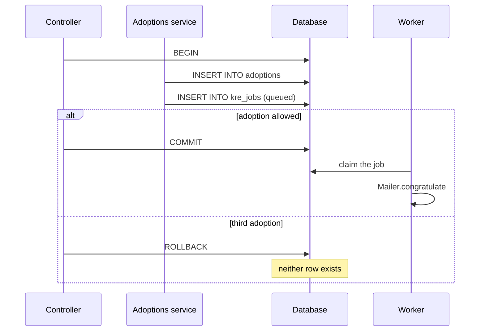
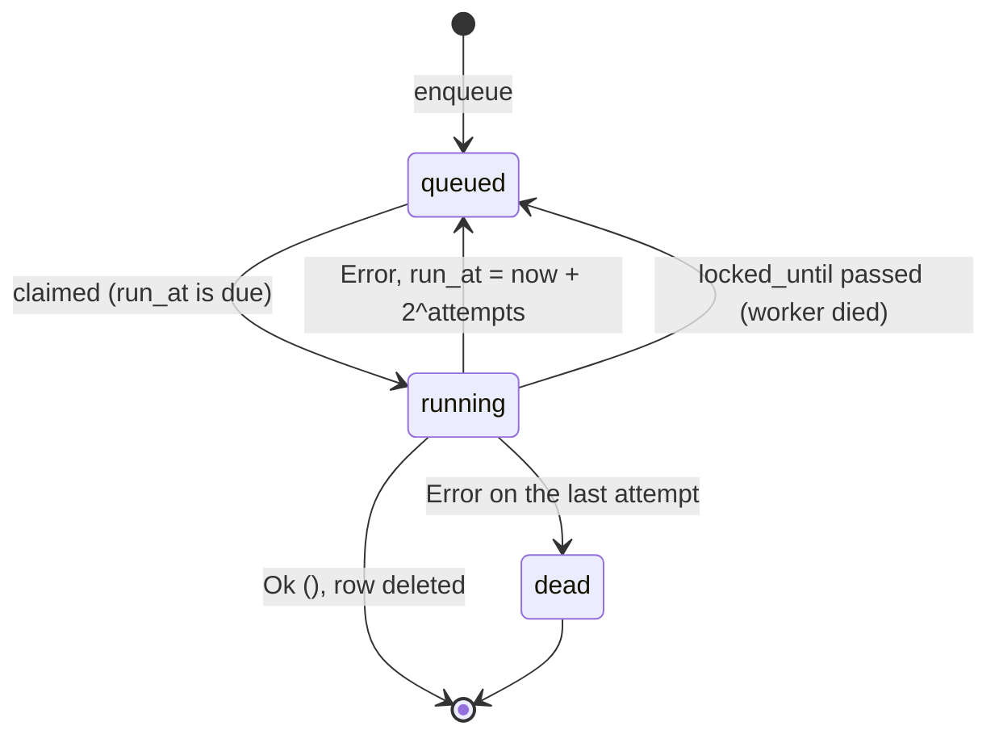

<script setup>
const life = [
  { title: 'Enqueue', sub: 'Jobs.enqueue writes a row through Db, inside the open transaction', code: 'status = queued', tone: 'ember' },
  { title: 'Claim', sub: 'The worker locks one due row with FOR UPDATE SKIP LOCKED', code: 'status = running', tone: 'amber' },
  { title: 'Parse', sub: 'The JSON payload goes back through the queue dto', code: 'Json.parse', tone: 'sky' },
  { title: 'Run', sub: 'The [@@job] handler returns Ok () or Error message', code: '(unit, string) result', tone: 'mint' },
  { title: 'Settle', sub: 'Delete on success, reschedule on failure, dead after the last attempt', code: 'DELETE / UPDATE', tone: 'violet' }
]
</script>

# Background jobs

<p class="lead">Kre keeps its job queue in the same database as your data. A queue is a typed value, a handler is a provider function with <code>[@@job]</code>, and enqueueing inside a transaction gives you the transactional outbox for free. No separate broker, no second process, no stringly-typed payloads.</p>

| | |
| --- | --- |
| Storage | one table, `kre_jobs`, next to your data |
| Brokers | none: no extra service or process |
| Retry pauses | 2, 4, 8 s, doubling until attempts run out |
| Lock lease | 5 min: a crashed worker loses its job |

Jobs live in one table, and rows are claimed with `SELECT … FOR UPDATE SKIP LOCKED`. Instead of a table per job kind, there is one `kre_jobs` table with a JSON payload, and every queue carries the dto that encodes and decodes it.

## A queue is a value

A queue has a name and a payload type. You create it once, at the top of a module, with `Kre.Job.queue` and the dto module of the payload:

<<< @/../examples/shelter/server/queues.ml

`Adoption.t Kre.Job.queue` is the whole contract. Enqueueing a `Cat.t` on it is a type error, and the handler for it must accept an `Adoption.t`. Any record with `[@@deriving dto]` works as a payload, because the queue only needs its JSON codec.

The public API is small:

<<< @/../src/core/job.mli

## The runner is a provider

`Kre.Job.Make` turns a database module into a job runner. In your application it is just another provider: a file with a `Make` functor that `[%wire]` applies like any service.

<<< @/../examples/shelter/server/jobs.ml

| Config value | Meaning |
| --- | --- |
| `poll` | Seconds the worker sleeps when there is nothing to do. |
| `attempts` | How many times a job runs before it is marked `dead`. |

Because the result is a `Kre.Job.S`, `[%wire]` knows it has lifecycle hooks: it calls `on_start` when the server boots and `on_shutdown` when it stops. The worker is a loop inside your server process. On shutdown it finishes the batch it is draining and exits.

::: info One provider, one database
The runner talks only to the `Db` you give it. Jobs live in whatever database that module points at, MariaDB or PostgreSQL, so they are backed up and replicated with the rest of your data.
:::

## Handlers: `[@@job queue]`

A handler is a function in a provider, marked with the queue it serves. It takes the payload and returns `(unit, string) result Lwt.t`. The shelter sends a letter when a cat is adopted:

<<< @/../examples/shelter/server/mailer.ml{21}

You never call `register` yourself. `[%wire]` finds every `[@@job]` binding in every provider and emits one line per handler, roughly:

```ocaml
Jobs.register (Kre.Job.handle Queues.congratulate Mailer.congratulate)
```

`Jobs` here is whichever provider implements `Kre.Job.S`. If none does, the build stops with the usual wiring error: `Mailer needs Kre.Job.S, but no provider gives it`. The type of `Kre.Job.handle` ties the queue and the function together, so a handler that takes the wrong payload does not compile either.

## Enqueueing and the free outbox

Any service that takes `(Jobs : Kre.Job.S)` as a module parameter can enqueue:

<<< @/../examples/shelter/server/adoptions_service.ml{9,32}

`Jobs.enqueue` is an `INSERT` through the same `Db` module the service uses. The adoption endpoint is marked `[@@transactional]`, so the insert of the adoption and the insert of the job share one transaction:

<<< @/../examples/shelter/server/adoptions_controller.ml{8}

That is the transactional outbox pattern without an outbox. If the request fails after the enqueue, the rollback removes the job together with the adoption. In the shelter, a member's third adoption returns `409 Conflict` after the row was written, the transaction rolls back, and no letter goes out. If the request commits, the job is guaranteed to be there.



Pass `?delay` (seconds) to run a job later:

```ocaml
Jobs.enqueue ~delay:3600. Queues.congratulate adoption
```

## The life of a job

<Flow :steps="life" caption="From enqueue to settle" />



Step by step:

- **Claim.** In one short transaction the worker selects the oldest due row, either `queued` with `run_at` in the past, or `running` whose `locked_until` has expired. `FOR UPDATE SKIP LOCKED` means several server instances can poll the same table without ever taking the same job. The row becomes `running`, `attempts` goes up by one and `locked_until` is set five minutes ahead.
- **Parse.** The payload goes through the queue's dto with `Kre_shared.Json.parse`. A payload that no longer parses, for example after a schema change, counts as a failure with the validation messages as the error.
- **Run.** The handler runs. An exception is caught and treated like `Error (Printexc.to_string exn)`.
- **Settle.** `Ok ()` deletes the row. `Error message` stores `last_error` and puts the job back to `queued` with `run_at` pushed forward by 2, 4, 8… seconds. When `attempts` reaches the configured limit, the row becomes `dead` and stays in the table for you to inspect.

::: warning Handlers run at least once
A worker that crashes mid-job leaves the row `running`. Five minutes later `locked_until` expires and another worker picks it up again. Write handlers that are safe to repeat.
:::

## The table

`Kre.Job.table` is an ordinary `Kre.Table.t`, so the schema tool prints its DDL for your dialect the same way it does for your own tables.

| Column | Purpose |
| --- | --- |
| `queue` | The queue name, used to find the handler. |
| `payload` | The payload as JSON, written by the queue dto. |
| `status` | `queued`, `running` or `dead`. Finished jobs are deleted. |
| `attempts` | How many times the job has been claimed. |
| `run_at` | When the job is due; indexed, because every claim orders by it. |
| `locked_until` | The lease of the worker that holds a `running` job. |
| `last_error` | The last failure message, kept for retries and dead jobs. |

Dead jobs are plain rows. Query them, fix the cause, and set them back to `queued` with SQL when you want a retry.

## Testing with `drain`

The worker polls in the background, which is awkward in a test. `Jobs.drain ()` runs everything that is due right now, synchronously from the test's point of view, and returns how many jobs it processed. The PostgreSQL test of the cats example enqueues three jobs, one of them in a transaction that rolls back, then drains:

```ocaml
let queue = Kre.Job.queue "greet" (module Cat) in
Jobs.register
  (Kre.Job.handle queue (fun (cat : Cat.t) ->
       Lwt.return
         (match Cat.Name.to_repr cat.name with
         | "tom" -> Error "tom is shy"
         | _ -> Ok ())));
(* one tom is enqueued in a rolled-back transaction, then felix and tom *)
let ran = Lwt_main.run (Jobs.drain ()) in
(* ran = 2; kre_jobs holds one row: queued, attempts 1, "tom is shy" *)
```

The rolled-back job never existed, felix succeeded and was deleted, and tom failed once and waits two seconds for his retry. The full test is in `examples/cats/postgresql/test_postgresql.ml`.

`drain` is also handy in scripts and [commands](/background/commands): enqueue, drain, exit.

::: tip Related
- [Transactions](/data/transactions) explains `[@@transactional]` and why `Db.query` joins the open transaction.
- [Mail](/background/mail) shows the `Mail` provider the shelter's job handler uses.
- [Schedules & events](/background/schedule-events) covers in-process work that does not need to survive a restart.
:::
