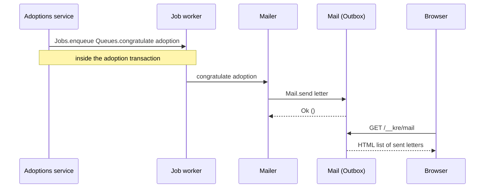
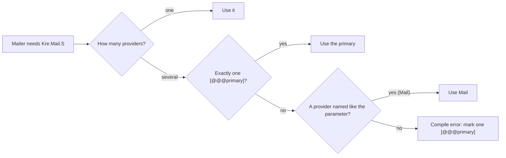

# Mail

<p class="lead">A letter in Kre is a plain value, <code>Kre.Mail.t</code>. Sending it is the job of a provider that implements <code>Kre.Mail.S</code>. Your code builds letters and calls <code>send</code>; which provider delivers them (SMTP, or an in-memory outbox with a preview page) is decided once, by <code>[%wire]</code>.</p>

<script setup>
const stats = [
  { value: '1', label: 'function to send', note: 'Mail.send : t -> (unit, string) result Lwt.t' },
  { value: '2', label: 'providers built in', note: 'Smtp and Outbox' },
  { value: '0', label: 'letters without a recipient', note: 'to_ is required by the type' }
]

const flow = [
  { title: 'Build', sub: 'Kre.Mail.make with typed addresses', code: 'Kre.Mail.t', tone: 'ember' },
  { title: 'Send', sub: 'Your code calls Mail.send on whatever provider it was given', code: 'Mail.send', tone: 'amber' },
  { title: 'Provider', sub: 'Outbox in dev and tests, Smtp in production', code: 'Kre.Mail.S', tone: 'mint' },
  { title: 'Deliver', sub: 'An RFC 5322 message on the wire, or a row on /__kre/mail', tone: 'sky' }
]

</script>

<StatGrid :stats="stats" />

<Flow :steps="flow" caption="From a value to a delivered letter" />

## Building a letter

`Kre.Mail.make` is the only way to get a `Kre.Mail.t`. The record is `private`, so you can read its fields (handy in tests) but not build one by hand and skip the rules.

```ocaml
val make :
  from:Kre_shared.Refined.Email.t ->
  to_:Kre_shared.Refined.Email.t ->
  ?cc:Kre_shared.Refined.Email.t list ->
  subject:string ->
  text:string ->
  ?html:string ->
  unit ->
  t
```

- **Addresses are refined types.** `from`, `to_` and every `cc` are `Kre_shared.Refined.Email.t`, the same type a DTO field uses. You get one by parsing with `Kre_shared.Refined.Email.of_repr`, so a malformed address is caught where it enters the system, not by the mail server.
- **There is always a recipient.** `to_` is a required labelled argument. A letter with no addressee cannot be constructed.
- **Text is mandatory, HTML is optional.** Every letter has a plain-text body. Pass `~html` and the letter becomes `multipart/alternative` with both parts.

Here is the whole public interface. It is short on purpose:

<<< @/../src/core/mail.mli

## What goes on the wire

`Kre.Mail.render` turns a letter into an RFC 5322 message. Both providers share it: SMTP sends exactly these lines inside `DATA`, and you can call it yourself to log or store a letter.

```ocaml
let letter =
  Kre.Mail.make ~from ~to_:ann ~cc:[ staff ]
    ~subject:"Welcome home, Tom 🐈"
    ~text:"Tom is yours."
    ~html:"<p>Tom is yours.</p>" ()

let () = print_string (Kre.Mail.render letter)
```

```text
From: shelter@shelter.test
To: ann@shelter.test
Cc: staff@shelter.test
Subject: =?UTF-8?B?V2VsY29tZSBob21lLCBUb20g8J+QiA==?=
Date: Sun, 01 Nov 2026 10:00:00 +0000
MIME-Version: 1.0
Content-Type: multipart/alternative; boundary="kre-eeba9c98d6add43778fac06e6e909893"

--kre-eeba9c98d6add43778fac06e6e909893
Content-Type: text/plain; charset=utf-8
Content-Transfer-Encoding: 8bit

Tom is yours.
--kre-eeba9c98d6add43778fac06e6e909893
Content-Type: text/html; charset=utf-8
Content-Transfer-Encoding: 8bit

<p>Tom is yours.</p>
--kre-eeba9c98d6add43778fac06e6e909893--
```

A few details you do not have to think about:

| Detail | What `render` does |
| --- | --- |
| Non-ASCII subject | Encoded as `=?UTF-8?B?…?=` (base64). An ASCII subject is left as is. |
| `Cc` | Written only when the list is not empty; every address also gets its own `RCPT TO` over SMTP. |
| Line endings | Lines are joined with `CRLF`; a stray `\r` at the end of a body line is dropped. |
| Boundary | Derived from the text and HTML bodies, so the same letter always renders the same parts. |
| Without `~html` | A single `text/plain; charset=utf-8` part, no multipart wrapper. |

## Providers

A provider is anything that satisfies the one-function signature:

```ocaml
module type S = sig
  val send : t -> (unit, string) result Lwt.t
end
```

Kre ships two.

### `Kre.Mail.Smtp`

A functor over the server address. It resolves the host, waits for the `220` greeting, then speaks `EHLO`, `MAIL FROM`, one `RCPT TO` per recipient, `DATA` (with dot-stuffing, so a body line starting with `.` survives) and `QUIT`. Any unexpected reply code, a refused connection or an unknown host comes back as `Error message`; `send` never raises.

```ocaml
module Smtp = Kre.Mail.Smtp (struct
  let host = "127.0.0.1"
  let port = 1025
  let helo = "shelter.test"
end)
```

::: warning No TLS yet
The SMTP provider talks plain text: no `STARTTLS`, no `AUTH`. Point it at a local relay (Postfix on the same host, a sidecar) or at a catcher like Mailpit during development. STARTTLS is planned.
:::

### `Kre.Mail.Outbox ()`

A generative functor: every application of it gets its own list of letters. `send` appends to that list and always succeeds. On top of `S` it gives you two things:

- `sent ()` returns the letters in the order they were sent, so a test can assert on them.
- `controller` is a ready-made `Kre.Controller.t` that serves **`GET /__kre/mail`**: a plain HTML page listing every letter with its subject, sender, recipient and body. HTML bodies are rendered in an `iframe`, text bodies as preformatted text. Use it to preview letters while developing.



## Mail in the shelter app

The shelter example sends a letter to the staff every time a cat is adopted. It takes three small files.

**The provider.** `mail.ml` applies the outbox and declares that it provides `Kre.Mail.S`. The floating `[@@@injectable]` tells `[%wire]` which interface this module implements, since it has neither a `Make` functor nor its own `module type S`:

<<< @/../examples/shelter/server/mail.ml

**The sender.** `Mailer` is an ordinary provider: a functor over any `Kre.Mail.S`. It never mentions the outbox. Its one function is also a [background job](/background/jobs) handler, attached to a typed queue with `[@@job Queues.congratulate]`, so the letter goes out after the adoption commits and is retried if `send` returns an error.

<<< @/../examples/shelter/server/mailer.ml

**The preview page.** `main.ml` mounts the outbox controller next to the actuator, live and profiler controllers, so `/__kre/mail` is available while the app runs:

<<< @/../examples/shelter/bin/main.ml{11-12}

**The test.** Because the outbox is just a module, the shelter test suite reads `Mail.sent ()` and checks that a committed adoption produced a letter while a rolled-back one did not. No SMTP server, no mocks.

```ocaml
List.filter
  (fun (letter : Kre.Mail.t) -> String.starts_with ~prefix:user letter.text)
  (Mail.sent ())
```

## Switching to SMTP

`Mailer.Make` asks for `Mail : Kre.Mail.S`, not for the outbox. To deliver real mail, add a second provider of the same interface and mark it `[@@@primary]`:

```ocaml
(* smtp_mail.ml *)
[@@@primary]
[@@@injectable Kre.Mail.S]

module Make () =
  Kre.Mail.Smtp (struct
    let host = "mail.internal"
    let port = 25
    let helo = "shelter.example"
  end)
```

When two providers give `Kre.Mail.S`, `[%wire]` resolves the dependency like this:



`[@@@primary]` wins over the parameter name, so `Smtp_mail` is chosen even though the parameter is called `Mail`. `Mailer` does not change by a single character. Remove the attribute, and the outbox is back.

::: tip Keep the outbox for tests
The usual setup is SMTP marked `[@@@primary]` in the production build and the outbox in tests, where you call `Mail.sent ()` directly. If you keep `mail.ml` around, the `/__kre/mail` page stays mounted but will simply be empty in production; drop `Mail.controller` from `main.ml` if you do not want it there.
:::

::: info Resolved while compiling
Kre picks the provider at build time: two candidates with no primary and no matching name is a build error with the file and line of the module that asked.
:::

## Related

- [Background jobs](/background/jobs): how `[@@job]` handlers run, retry and die.
- [Dependency injection](/guide/dependency-injection): providers, `[@@@injectable]` and `[@@@primary]` in general.
- [Validation & types](/guide/validation): where `Refined.Email.t` comes from.
