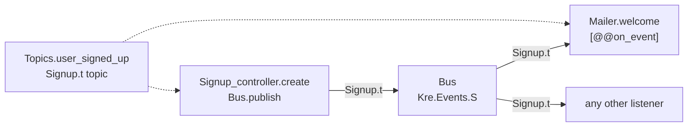

<script setup>
const lifecycle = [
  { title: '[%wire]', sub: 'Collects every scheduled function and every listener', code: 'Kre.Schedule.job', tone: 'ember' },
  { title: 'on_start', sub: 'Provider hooks run, then the schedules start', code: 'Schedule.start', tone: 'amber' },
  { title: 'Running', sub: 'Each task sleeps until it is due; a failure is logged and the schedule goes on', tone: 'mint' },
  { title: 'on_shutdown', sub: 'Schedules are cancelled first, then provider hooks run in reverse', tone: 'violet' }
]
</script>

# Schedules & events

<p class="lead">Two kinds of in-process background work, both declared with an attribute on a provider function. Schedules run a function on a cron expression, an interval or once after start. Events deliver a typed value from the code that publishes it to every function that listens. <code>[%wire]</code> connects both at build time.</p>

Both work without reflection. They run inside the server process and do not survive a restart. For work that must not be lost, use [background jobs](/background/jobs), which live in the database.

## Scheduled tasks

A scheduled task is a function `unit -> unit Lwt.t` in any provider, with one of three attributes:

| Attribute | When it runs |
| --- | --- |
| `[@@cron "0 3 * * *"]` | On a cron expression: minute, hour, day, month, weekday, in UTC. |
| `[@@interval 30.0]` | Every N seconds. |
| `[@@after 5.0]` | Once, N seconds after start. |

The events example has a mailer that sends a digest on an interval:

<<< @/../examples/events/server/mailer.ml{21-24}

That is all. There is no scheduler module to import and no registry to fill. `[%wire]` turns every such function into a `Kre.Schedule.job` named after its provider and function, here `Mailer.digest`:

<<< @/../src/core/schedule.mli

### The schedule lifecycle

<Flow :steps="lifecycle" caption="Schedules follow the application lifecycle" />

Schedules start after the providers' own `on_start` hooks, so migrations and pools are ready before the first tick. On shutdown they are cancelled before the providers stop. The events test checks exactly this: the digest runs a few times between `on_start` and `on_shutdown`, and not once after.

An exception in a task is logged with the task name (`job Mailer.digest failed: …`) and the schedule keeps going. One bad run never stops the next.

::: info Commands start schedules too
[Commands](/background/commands) run between `on_start` and `on_shutdown` like the server does, so scheduled tasks are live while a command runs.
:::

### Cron expressions are checked at build time

The ppx parses the cron string with `Kre_shared.Cron` while it compiles your code. A mistake is a build error that points at the attribute:

```
File "./app/clock.ml", line 3, characters 31-52:
Error: [@cron "61 * * * *"]: minute 61 is outside 0-59
```

Each field accepts `*`, a number, a range `1-5`, a step `*/15` or `0-30/10`, and lists of those separated by commas. The ranges are minute 0–59, hour 0–23, day 1–31, month 1–12 and weekday 0–6. Seconds for `[@@interval]` and `[@@after]` must be float literals: `[@@interval 30]` is rejected, and the error suggests `[@@interval 30.0]`.

## Typed events

An event system needs three things: a name, a bus, and listeners. In Kre each has a type.



### A topic is a typed value

<<< @/../examples/events/server/topics.ml

`Signup.t Kre.Events.topic` fixes the payload type. Publishing an `int` to it, or listening with a function of another type, does not compile. The string is the name used in logs.

### The bus is a provider

<<< @/../examples/events/server/bus.ml

`Kre.Events.Make ()` is a generative functor, so each application gets its own bus. It is wired like any other provider:

<<< @/../src/core/events.mli

### Publishing

Anything that publishes takes the bus as a module parameter:

<<< @/../examples/events/server/signup_controller.ml{3-5}

`publish` calls every listener of the topic concurrently and resolves when all of them are done. An exception in a listener is logged with the topic name and does not reach the publisher, so one broken listener cannot fail the signup.

### Listening: `[@@on_event]`

A listener is a provider function with the topic in an attribute. In the mailer above, `welcome` is one:

```ocaml
let welcome (signup : Signup.t) =
  outbox := ("welcome " ^ signup.email) :: !outbox;
  Lwt.return_unit
[@@on_event Topics.user_signed_up]
```

`[%wire]` emits `Bus.subscribe Topics.user_signed_up Mailer.welcome` for it. Because `subscribe` is typed by the topic, a listener that takes the wrong type is a type error at that line. If no provider implements `Kre.Events.S`, the build stops:

```
Error: Clock needs Kre.Events.S, but no provider gives it: add a module with Make or module type S that implements it
```

::: details How one bus stores listeners of many types
Each topic carries a `Type.Id.t` from the OCaml 5 standard library. The bus keeps listeners in one list of an existential type and, on publish, asks `Type.Id.provably_equal` whether a listener's topic is the one being published. If it is, the compiler has a proof that the payload types are equal and the call is well typed. There is no `Obj.magic` and no cast.
:::

### The whole flow, tested

The events test posts a signup and reads the mailer's outbox through a second endpoint:

```ocaml
let signed_up = call `POST "/signup" {|{"email":"ann@x.io"}|} in
(* signed_up = (204, "") *)
call `GET "/signup/outbox" ""
(* (200, {|["welcome ann@x.io"]|}) *)
```

The controller never mentions the mailer when it publishes. The only link between them is the topic, and `[%wire]` makes the subscription.

## Events or jobs?

| | Events | Jobs |
| --- | --- | --- |
| Where it lives | Memory of one process | The `kre_jobs` table |
| Survives a restart | No | Yes |
| Joins the transaction | No, listeners run when you publish | Yes, rollback removes the job |
| Retries | No, failures are logged | Yes, with doubling pauses |
| Best for | Fan-out inside the app, caches, metrics | Mail, webhooks, anything that must happen |

::: tip Related
- [Dependency injection](/guide/dependency-injection) explains providers and `[%wire]`.
- [Background jobs](/background/jobs) covers durable work with retries.
- [Actuator & profiler](/tooling/observability) shows the beans graph and health checks, like the `[@@health "mailer"]` check in the same file.
:::
