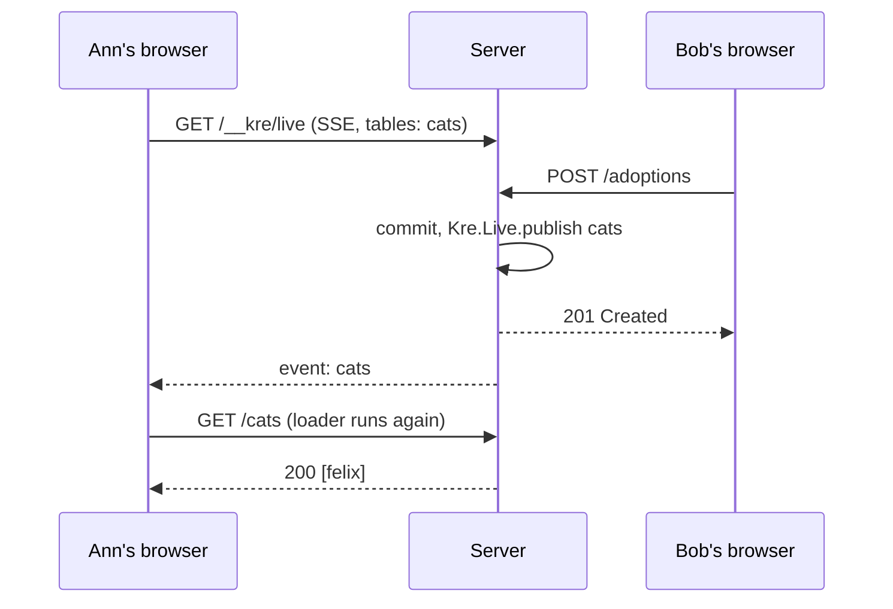

# Typed client & router

<p class="lead">Your controllers already describe the API, so Kre writes the client for you: one module per controller, generated from the server's spec and compiled for the browser and for native tests alike. On top of it sits a typed page router, where a wrong link or a missing query parameter is a type error, not a 404.</p>

<script setup>
const pipeline = [
  { title: 'Controller', sub: 'Handlers with labelled arguments and [@@get]', code: 'cats_controller.ml', tone: 'ember' },
  { title: 'spec.json', sub: 'main.exe --emit-spec writes every route', code: '--emit-spec', tone: 'amber' },
  { title: 'kre client', sub: 'One module per controller prefix', code: '--controller cats', tone: 'mint' },
  { title: 'Cats_client', sub: 'Plain functions over Http.request', code: 'cats_client.ml', tone: 'sky' },
  { title: 'Two targets', sub: 'Melange + fetch in the browser, cohttp + Lwt natively', tone: 'violet' }
]
const stats = [
  { value: '0', label: 'hand-written fetch calls', note: 'every call is generated from the spec' },
  { value: '1', label: 'generated file', note: 'compiled for Melange and for native' },
  { value: '3', label: 'kinds of error', note: 'Problem, Network, Decode' }
]
</script>

<StatGrid :stats="stats" />

## From controller to client

The contract lives in the controller. `kre-ppx` emits a `spec` value next to every controller, `main.exe --emit-spec spec.json` writes all of them to a file, and `kre client` turns one controller's spec into an OCaml module. Nothing in between can drift, because nothing in between is written by hand.

<Flow :steps="pipeline" caption="How a controller becomes a client module" />

A dune rule runs the generator, so the client is rebuilt whenever a route changes. This is the rule in `examples/cats/client_js/dune`:

```lisp
(rule
 (targets cats_client.ml)
 (deps ../client_native/spec.json)
 (action
  (run %{bin:kre} client
   --spec ../client_native/spec.json
   --controller cats
   --out %{targets})))
```

`--controller` takes the controller prefix (`cats` for `[@@@controller "cats"]`). The shelter app runs the generator three times in one rule, for `auth`, `cats` and `adoptions`.

## What a generated client looks like

Here is the controller the cats example starts from:

<<< @/../examples/cats/server/cats_controller.ml

And this is what `kre client` writes for it, verbatim from `_build/default/examples/cats/client_js/cats_client.ml`:

```ocaml
(* Generated by kre client from the /cats controller; do not edit. *)

let find_all ~search =
  Kre_client.Http.request `GET
    ~path:[ "cats" ]
    ~query:
      [
        Kre_client.Wire.search Cat_search.codec search;
      ]
    (Kre_client.Wire.Json (module Kre_shared.Json.List (Cat)))

let find_one ~id =
  Kre_client.Http.request `GET
    ~path:[ "cats"; Kre_client.Wire.segment (module Cat.Id) id ]
    (Kre_client.Wire.Json (module Cat))

let create ~body =
  Kre_client.Http.request `POST
    ~path:[ "cats" ]
    ~body:(Kre_client.Wire.body (module Create_cat_dto) body)
    (Kre_client.Wire.Json (module Cat))

(* Tables each [@@live] route reloads on; pass to Router.child ~live. *)
module Live = struct
  let find_all = [ "cats" ]
end
```

A few things to notice:

- **Labels mirror the handler.** A path parameter `~id` stays `~id`, the body is `~body`, a `[@search]` record is `~search`. A handler with no request parameters gets a trailing `()`, like `Cats_client.available ()` in the shelter.
- **No types are printed.** The generator names modules (`Cat`, `Cat.Id`, `Create_cat_dto`) and the compiler infers the rest. That is why DTOs must live in `shared/`: the browser build needs them too.
- **Guards disappear.** `~user` with `[@guard Auth.user]` is resolved on the server from headers, so it is not part of the client signature.
- **`Live` lists tables.** Every handler marked `[@@live [ "cats" ]]` gets an entry, ready to pass to the router.

::: info One file, two targets
The same `cats_client.ml` compiles against two libraries that are both called `Kre_client`: `kre-client` (Melange, `fetch`, `Js.Promise.t`) and `kre-client.native` (cohttp, `Lwt.t`). There is no `--target` flag. The native build is what the end-to-end and in-process tests use — see [Testing](/tooling/testing).
:::

## Http and Wire

Generated code calls two small modules. `Kre_client.Wire` is shared by both backends: it encodes path segments, query strings and bodies with the same `Kre_shared.Scalar` and JSON codecs the server uses, and decodes the answer.

<<< @/../src/client/wire.mli

`Kre_client.Http` is the part each backend implements. Two mutable references decide where requests go and which headers they carry.

<<< @/../src/client/http.mli

The shelter login page stores the session token there once, and every later call is authenticated:

```ocaml
Kre_client.Http.headers := [ ("Authorization", "Bearer " ^ session.token) ]
```

`base_url` defaults to the page's own origin. Tests running in node point it at a local server with `Kre_client.Http.base_url := "http://127.0.0.1:" ^ port`.

## Errors are Problem Details

Every generated function returns `('a, Kre_client.Error.t) result` inside a promise. The server answers errors as RFC 9457 Problem Details, and the client parses them back into a record, including the path of every failed field on a 422.

<<< @/../src/client/error.mli

So a page can match on exactly what went wrong:

```ocaml
let show = function
  | Ok text -> "ok " ^ text
  | Error (Kre_client.Error.Problem problem) ->
      Printf.sprintf "problem %d %s" problem.status problem.type_
  | Error error -> "error " ^ Kre_client.Error.message error
```

That is the helper from the shelter's node scenario. Running it against a live server prints lines like these:

| Call | Result |
| --- | --- |
| a member adds a cat | `problem 403 urn:kre:error:forbidden` |
| a member adopts tom | `ok tom` |
| adopting tom again | `problem 409 urn:kre:error:conflict` |
| a cat with a note that is too long | `problem 422 urn:kre:error:validation note:max_length` |

`Network` means no answer arrived at all; `Decode` means the answer did not match its type — a server and client built from different specs, for example.

## The typed router

`Kre_client.Router` models pages as typed values: a route is a value that carries the types of its path params `'p`, its search params `'s` and its loader data `'d`. Links and navigation take those types, so the compiler checks every link in the app.

<<< @/../src/client/router.mli

The whole router of the cats example fits on one screen:

<<< @/../examples/cats/client_js/routes.ml

- `Router.root ~layout ()` is where routes are mounted. `Router.nest parent ~layout` adds another layout inside it.
- `Router.child` declares a page: its path, its search codec, a loader that receives the parsed params and search, and the component that renders the loader's result.
- `Router.make` lists routes in matching order. The first one whose path and search both parse wins; a search that fails to parse counts as no match.

`search` and `loader` are required even when a page has neither: an optional argument cannot change a type in OCaml. Use `Kre_shared.Search.none` and `Kre_client.Router.no_data` for those.

### Path params

A path with parameters is declared together with its record, so the ppx can compare them:

```ocaml
type params = { id : Cat.Id.t } [@@deriving params ~path:"/cats/:id"]
```

This generates `params_path : params Kre_client.Path.t`. Every `:segment` needs a field and every field needs a segment; field types are `Kre_shared.Scalar.S` modules, the same ones the server parses with. A path without parameters is just `[%path "/cats"]`.

::: warning What the compiler says
From `test/router/link.t`:

```text
Error: path /cats/:id and the record disagree: segments without a field: []; fields without a segment: [slug]
```

```text
Error: [%path "/cats/:id"] has parameters; declare them with type params = { … } [@@deriving params ~path:"/cats/:id"]
```

And a link with the wrong params is an ordinary type error:

```text
Error: This expression should not be a unit literal, the expected type is
       params
```
:::

### Search params, shared with the server

A search record is a `[@@deriving search]` type in `shared/`. The same module is read by the server handler with `[@search]` and written by the client and the router:

<<< @/../examples/cats/shared/cat_search.ml

A field of type `'a option` is optional, `'a list` is repeated, `[@default e]` has a default, and anything else is required. The derived `codec` is a `Kre_shared.Search.t`, so one value serves three places:

```ocaml
(* server: cats_controller.ml *)
let find_all (module Cats : Cats_service.S) ~(search : (Cat_search.t[@search])) () = …

(* client: generated cats_client.ml *)
Kre_client.Wire.search Cat_search.codec search

(* router: routes.ml *)
Kre_client.Router.child root ~path:[%path "/cats"] ~search:Cat_search.codec …
```

Parse failures come back as `Kre_shared.Validation.t` with the parameter name as the path — `?limit=many` gives `limit:type`.

### Links, hrefs and navigation

```ocaml
Kre_client.Router.href Routes.Cats.show ~params:{ id } ~search:()
(* "/cats/42" *)

Kre_client.Router.href Routes.Cats.index ~params:()
  ~search:{ limit = 5; breed = Some maine_coon }
(* "/cats?limit=5&breed=maine%20coon" *)

Kre_client.Router.link Routes.Cats.show ~params:{ id } ~search:()
  ~children:(React.string "tom")
(* <a href="/cats/3">tom</a>, with a client-side push on click *)

Kre_client.Router.navigate Routes.Cats.index ~params:() ~search:()
```

Those outputs come from `examples/cats/client_js/router_check.mlx`, which runs in node as part of `dune test`.

### Mounting the router

`Router.View` is a reason-react component that matches the current URL, runs the loader and renders the page inside its layouts. Until the loader resolves it shows `pending`; an unknown URL shows `not_found` ("Not found" by default).

<<< @/../examples/cats/web/app.mlx

## The shelter routes

A larger router, with authentication and a page that links to another route:

<<< @/../examples/shelter/client/routes.mlx

Two details are worth copying. The login page sets `Http.headers` and then calls `Router.navigate` with typed params. And `Pages.cats` receives a `~link` function instead of referring to `Routes` itself: routes depend on pages, so pages cannot depend on routes, and passing the link in keeps both modules acyclic.

## Live routes

A handler marked `[@@live [ "cats" ]]` declares which tables it reads. The generated `Cats_client.Live.find_all` carries that list; pass it to `Router.child ~live`, and the page reloads its loader whenever one of those tables changes — for every user who has it open.



The server side needs `Kre.Live.controller` mounted, which serves `/__kre/live`. No triggers or `LISTEN/NOTIFY` are involved, so it works the same on MariaDB and Postgres. The full story, including how the declared tables are audited in tests, is on [Live loaders](/data/live).

You can also subscribe without the router: `Kre_client.Live.watch Cats_client.Live.available (fun table -> …)` returns a function that stops the subscription.

## What next

::: tip Write the pages
[Pages in mlx](/client/pages) shows the components behind `Pages.cats`, `Pages.cat` and the login form.
:::

::: info Call someone else's API
[Calling other APIs](/client/http-client) generates the same kind of client from a signature, for services that are not Kre.
:::
