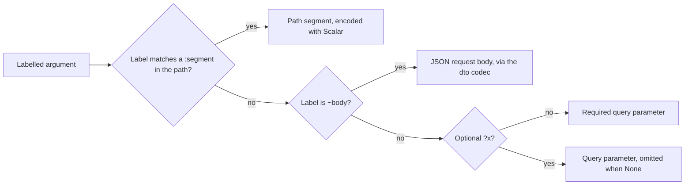
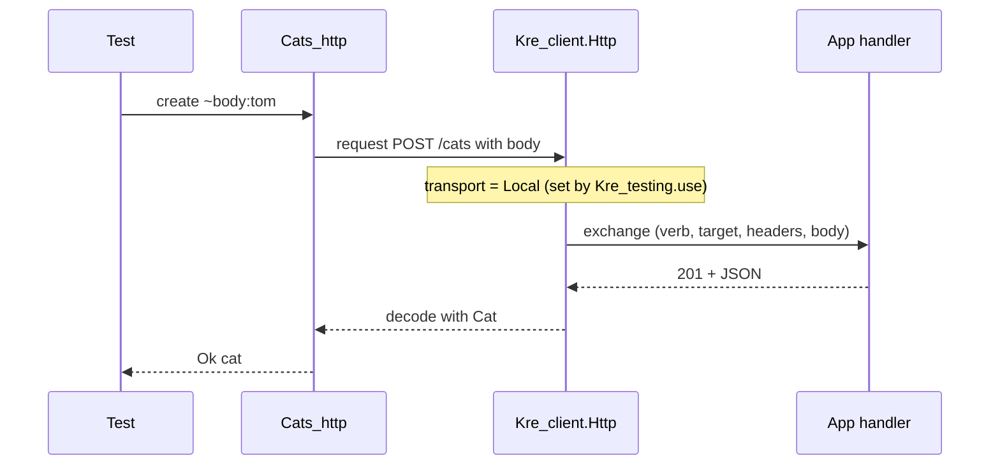

# Calling other APIs

<p class="lead">To talk to someone else's HTTP API, you write down its calls as an OCaml signature. <code>[%http_client: …]</code> turns that signature into a functor over the base URL and headers. Arguments go to the path, the query or the body by their labels, answers are decoded into your types, and the same declaration compiles for the server, for the browser and for in-process tests.</p>

<script setup>
const stats = [
  { value: '1', label: 'declaration', note: 'a signature with one verb per call' },
  { value: '3', label: 'places it runs', note: 'native (cohttp), Melange (fetch), in-process tests' },
  { value: '0', label: 'hand-written URLs', note: 'paths, queries and bodies are generated' }
]

const flow = [
  { title: 'Declare', sub: 'val user : login:string -> User.t with [@@get]', tone: 'ember' },
  { title: 'Expand', sub: 'kre-ppx writes a functor over url and headers', code: 'Config -> sig … end', tone: 'amber' },
  { title: 'Configure', sub: 'Apply it once, like forRoot in NestJS', code: 'Api (struct … end)', tone: 'mint' },
  { title: 'Call', sub: 'A typed result: your value or a Kre_client.Error.t', code: '(T, Error.t) result', tone: 'sky' }
]

const compare = [
  { topic: 'Declaring calls', elsewhere: 'Spring: an interface with @HttpExchange; Nest: HttpService calls with string URLs; Symfony: HttpClient requests by hand', kre: 'A signature inside [%http_client: …], one verb attribute per value' },
  { topic: 'Path and query', elsewhere: 'Annotations on each parameter (@PathVariable, @RequestParam) or string building', kre: 'Inferred from labels: :segment, ~body, other labels are query, ?x is optional' },
  { topic: 'Mistakes', elsewhere: 'A missing path variable fails on the first request', kre: 'A :segment without its label is a compile error at the declaration' },
  { topic: 'Response type', elsewhere: 'A generic or an Observable, cast or mapped by hand', kre: 'Decoded with the dto codec of the declared type; a mismatch is Error (Decode …)' },
  { topic: 'Errors', elsewhere: 'Exceptions (WebClientResponseException, AxiosError)', kre: 'A result value: Problem, Network or Decode' },
  { topic: 'Testing', elsewhere: 'A mock server or a stubbed HTTP module', kre: 'Kre_testing.use routes calls into the app handler, no socket' }
]
</script>

<StatGrid :stats="stats" />

<Flow :steps="flow" caption="From a signature to a typed call" />

## Declare the API

Here is a GitHub client with three calls. Each `val` is one endpoint; its attribute names the HTTP verb and the path.

```ocaml
module Github_api =
  [%http_client:
  val user : login:string -> Github_user.t [@@get "/users/:login"]
  val repos : login:string -> ?per_page:int -> unit -> Repo.t list
  [@@get "/users/:login/repos"]
  val star : owner:string -> repo:string -> unit
  [@@put "/user/starred/:owner/:repo"]]

module Github = Github_api (struct
  let url = "https://api.github.com"
  let headers = [ ("Authorization", "Bearer " ^ Settings.config.github_token) ]
end)

let%lwt user = Github.user ~login:"octocat"
```

`Github_api` is a functor. Applying it to a module with `url` and `headers` gives you `Github`, whose functions perform the requests. You configure the client once, where you have the settings, and pass `Github` around like any other module (or make the application a [provider](/guide/dependency-injection) so `[%wire]` hands it to whoever needs it).

The verb attributes are `[@@get]`, `[@@post]`, `[@@put]`, `[@@patch]` and `[@@delete]`.

## Where each argument goes

You never say "this is a path parameter". The label decides:



| Argument | Goes to | Encoded with |
| --- | --- | --- |
| `~login:string` with `"/users/:login"` | the path | `Kre_shared.Scalar.String` |
| `~id:Cat.Id.t` with `"/cats/:id"` | the path | `Cat.Id` (any `Kre_shared.Scalar.S`) |
| `~body:Create_cat_dto.t` | the JSON body | `Create_cat_dto` (its `[@@deriving dto]` codec) |
| `~page:int` | the query, always sent | `Kre_shared.Scalar.Int` |
| `?per_page:int` | the query, only when given | `Kre_shared.Scalar.Int` |
| `unit` | nothing; closes optional arguments | |

Path and query values may be `int`, `int64`, `float`, `bool`, `string` or `M.t` where `M` is a scalar, such as a refined id. These are the same parsers and printers your [controllers](/guide/controllers) use, so a `Cat.Id.t` is printed the same way on both sides of the wire.

## What it returns

The declared result type is what you get back on success. Kre wraps it in a `result` and a promise:

| Declared result | You get | Decoded by |
| --- | --- | --- |
| `unit` | `(unit, Kre_client.Error.t) result` | nothing; the body is ignored |
| `string` | `(string, Kre_client.Error.t) result` | the raw body |
| `User.t` | `(User.t, Kre_client.Error.t) result` | `User`'s JSON codec |
| `Repo.t list` | `(Repo.t list, Kre_client.Error.t) result` | `Kre_shared.Json.List (Repo)` |
| `Cat.t Kre_shared.Page.t` | `(Cat.t Kre_shared.Page.t, Kre_client.Error.t) result` | `Kre_shared.Page.Make (Cat)` |

On the server the promise is `Lwt.t`; when the same file is compiled with Melange it is `Js.Promise.t`. You write the declaration once.

## What the ppx writes

This is the real expansion from the ppx test suite (`test/ppx/http_client.t`). There is no runtime reflection and no generic HTTP layer to configure: every call becomes one `Kre_client.Http.request` with its path, query and decoder spelled out.

```ocaml
module Api(Config:sig val url : string val headers : (string * string) list
                  end) :
  sig
    val user : login:string -> (User.t, Kre_client.Error.t) result Lwt.t
    val repos :
      login:string ->
        ?per_page:int ->
          unit -> (Repo.t list, Kre_client.Error.t) result Lwt.t
    val star :
      owner:string ->
        repo:string -> (unit, Kre_client.Error.t) result Lwt.t
  end =
  struct
    let user ~login =
      Kre_client.Http.request ~base:Config.url `GET
        ~path:["users";
              Kre_client.Wire.segment (module Kre_shared.Scalar.String)
                login] ~query:[] ~headers:[Config.headers]
        (Kre_client.Wire.Json (module User))
    let repos ~login ?per_page () =
      Kre_client.Http.request ~base:Config.url `GET
        ~path:["users";
              Kre_client.Wire.segment (module Kre_shared.Scalar.String)
                login;
              "repos"]
        ~query:[Kre_client.Wire.query (module Kre_shared.Scalar.Int)
                  Kre_shared.Presence.Optional "per_page" per_page]
        ~headers:[Config.headers]
        (Kre_client.Wire.Json (module (Kre_shared.Json.List)(Repo)))
    let star ~owner ~repo =
      Kre_client.Http.request ~base:Config.url `PUT
        ~path:["user";
              "starred";
              Kre_client.Wire.segment (module Kre_shared.Scalar.String)
                owner;
              Kre_client.Wire.segment (module Kre_shared.Scalar.String)
                repo] ~query:[] ~headers:[Config.headers]
        Kre_client.Wire.Unit
  end
```

`Kre_client.Http` and `Kre_client.Wire` are exactly what the [generated clients for your own API](/client/client-router) use. Learn one, and you know both.

::: warning What happens if you get it wrong
Mistakes in the declaration stop the build, pointing at the `val`:

```text
module Api = [%http_client: val user : unit -> User.t [@@get "/users/:login"]]
Error: the path has :login; add ~login to user
```

```text
module Api = [%http_client: val user : unit -> User.t]
Error: user needs one verb with a path: [@@get "/users/:login"]
```

An unlabelled argument other than `unit`, or a path value that is not a scalar, is rejected the same way, with a message that says what to write instead.
:::

## Errors are values

A call never raises. Anything that is not a success arrives as `Error` with one of three cases:

```ocaml
type t =
  | Problem of problem
  | Network of string
  | Decode of Kre_shared.Validation.t
```

- **`Problem`**: the server answered with a status of 400 or more. If the body is an RFC 9457 Problem Details document (what every Kre server returns), its `type`, `title`, `detail` and the per-field `errors` of a 422 are parsed into the record. Otherwise you still get the `status`, with the body as `detail`.
- **`Network`**: no answer at all: DNS, refused connection, timeout.
- **`Decode`**: the server answered 2xx, but the body did not match the declared type. You get the same validation errors, with field paths, that a Kre controller produces for a bad request.

`Kre_client.Error.message` turns any of them into a line of text.

## Testing without a network

On the native side, `Kre_client.Http.transport` is either `Network` (cohttp) or `Local handler`. `Kre_testing.use` sets it to `Local` with your application's handler, so a declared client calls your controllers in-process: real routing, guards, validation and JSON, but no socket and no port.

This test from `examples/cats` declares a client for the cats API, points it at a made-up host and runs it against the real controller:

<<< @/../examples/cats/client_native/test_in_process.ml{9-18,33}

The `outcome` helper shows how you consume a result: success, a `Problem` with its status and field errors (a 422 for a note that is too long, a 404 for a missing cat), or any other error as a message. With `Local`, the base URL is ignored, so `http://cats.internal` never resolves; the request goes straight into the handler.



::: tip Global headers
`Kre_client.Http.headers` is a ref sent with every request, before the client's own `Config.headers`. The test above uses it to act as a user (`X-User: ann`); in the browser you would put a session token there.
:::

## How it compares

<Compare :rows="compare" left="Spring / Nest / Symfony" right="Kre" />

## Related

- [Typed client & router](/client/client-router): clients generated from your own OpenAPI spec, on the same `Http` and `Wire`.
- [Errors & interceptors](/guide/errors): the Problem Details a Kre server sends.
- [Testing](/tooling/testing): `Kre_testing` and in-process calls.
