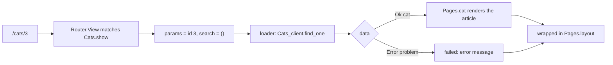
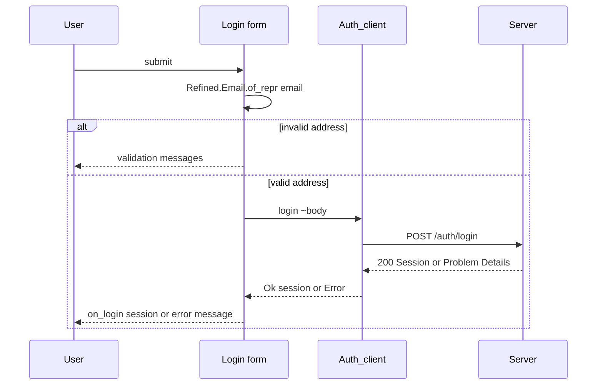

# Pages in mlx

<p class="lead">Pages are reason-react components written in .mlx files — OCaml with JSX. You get the markup you know from React, hooks included, while every prop, every API call and every route link is checked by the OCaml compiler.</p>

<script setup>
const build = [
  { title: 'pages.mlx', sub: 'OCaml with JSX tags', tone: 'ember' },
  { title: 'mlx-pp', sub: 'dune dialect turns JSX into OCaml', tone: 'amber' },
  { title: 'reason-react-ppx', sub: 'Elements and components become React calls', tone: 'mint' },
  { title: 'Melange', sub: 'Compiles the module to JavaScript', tone: 'sky' },
  { title: 'Browser or node', sub: 'ReactDOM in the page, renderToStaticMarkup in tests', tone: 'violet' }
]
const stats = [
  { value: '.mlx', label: 'one file type for JSX', note: 'no hand-written [@JSX] anywhere' },
  { value: '3', label: 'arguments per page', note: 'data, params, search' },
  { value: '1', label: 'formatter', note: 'ocamlformat-mlx through dune fmt' }
]
</script>

<StatGrid :stats="stats" />

## The mlx dialect

`.mlx` is a dune dialect: dune knows how to preprocess it, how to format it and how to feed it to Merlin. Kre declares it once in `dune-project`:

```lisp
(dialect
 (name mlx)
 (implementation
  (extension mlx)
  (merlin_reader mlx)
  (format
   (run ocamlformat-mlx %{input-file}))
  (preprocess
   (run mlx-pp %{input-file}))))
```

After that, any `foo.mlx` in a Melange library is a normal module named `Foo`. `dune build @fmt` formats it with `ocamlformat-mlx`, and your editor gets types and completion through the `mlx` Merlin reader.

<Flow :steps="build" caption="From a .mlx file to a rendered page" />

The library needs the usual Melange and React preprocessors. This is the shelter client:

```lisp
(library
 (name shelter_client)
 (modes melange)
 (libraries shelter_shared_js kre-client kre-client.shared
  jsonkit-melange reason-react)
 (preprocess
  (pps melange.ppx reason-react-ppx kre-ppx)))
```

::: tip The rule
JSX lives only in `.mlx` files. There are no hand-written `[@JSX]` attributes and no `React.createElement` calls in the examples or in Kre itself — even `Kre_client.Router` is written in `.mlx`.
:::

## JSX, the OCaml way

The syntax is JSX with OCaml expressions in the holes:

- Lowercase tags are DOM elements: `<ul>`, `<form onSubmit=submit>`. Attributes that clash with keywords get an underscore: `type_="email"`.
- Uppercase tags are components: `<Adopt cat />` calls `Adopt.make`, and `<Pages.Login on_login=ignore />` reaches into another module.
- Punning works like labels: `<Adopt cat />` is `<Adopt cat=cat />`.
- Children are expressions in parentheses. Text is explicit: `(React.string "Adopt")`. Lists go through `React.array`.
- A variable can be a child on its own: `<main>children</main>`.

The smallest page in the repository shows all of it:

<<< @/../examples/cats/client_js/pages.mlx

## The shape of a page

A route's component receives three labelled arguments: `~data` (what the loader returned), `~params` and `~search` (the parsed URL). Their types come from the route — see [Typed client & router](/client/client-router) — so the page cannot read a parameter that the path does not have.

Because loaders call generated clients, `data` is a `result`: `Ok` with the typed value, or `Error` with a `Kre_client.Error.t`. The shelter pages handle both with `Result.fold` and one shared error view:

```ocaml
let failed error =
  <p className="error">(React.string (Kre_client.Error.message error))</p>
```



## The shelter pages

Here is the whole page module of the shelter app: a layout, two components with state, and three pages.

<<< @/../examples/shelter/client/pages.mlx

### Components with hooks

`Adopt` and `Login` are reason-react components: a module with a `make` function marked `[@react.component]`. Inside, React hooks are plain functions — `React.useState` returns a pair, and the setter takes a function of the previous state.

The **Adopt button** calls the generated `Adoptions_client.adopt` with a typed body, `{ Adopt_dto.cat_id = cat.id }`. A wrong field name or a string where a `Cat.Id.t` belongs does not compile. The answer is folded into a message: `"adopted"`, or the server's Problem Details text — for instance when someone else adopted the cat a moment earlier and the transaction answered 409.

The **Login form** parses before it sends. `Kre_shared.Refined.Email.of_repr` is the same parser the server runs on the `Login_dto` body, compiled to JavaScript. An invalid address never leaves the browser; the validation messages are shown right away. A valid one becomes a `Kre_shared.Refined.Email.t`, which is the only type `Login_dto.email` accepts.



### Variants drive the markup

`Pages.cat` matches on `cat.status`. `Available` renders the `Adopt` button, `Adopted` renders a note. `Cat.Status.t` is a variant from `shared/`, so adding a state on the server makes this `match` non-exhaustive and the client build fails until the page handles it.

### Links without a cycle

`Pages.cats` takes a `~link` argument instead of calling `Router.link` itself. Routes refer to pages, so pages cannot refer to routes; the router passes the link in when it mounts the page:

```ocaml
~component:
  (Pages.cats ~link:(fun (cat : Cat.t) children ->
       Kre_client.Router.link show ~params:{ id = cat.id } ~search:()
         ~children))
```

The partial application still has the exact component type the router expects, and the link is still checked against `show`'s params.

## Layouts

A layout is a function of `~children`. Pass it to `Router.root`, and every page mounted there is rendered inside it:

```ocaml
let layout ~children = <main>children</main>

let root = Kre_client.Router.root ~layout:Pages.layout ()
```

For a section with its own chrome — an admin area, say — `Router.nest` adds an inner layout to a parent. Layouts are applied outermost first:

```ocaml
let admin = Kre_client.Router.nest root ~layout:Pages.admin_layout
```

## Mounting in the browser

The entry point renders `Router.View` into the page. It also sets default headers for every generated client call:

<<< @/../examples/cats/web/app.mlx

## Rendering in node for tests

Pages are plain functions returning `React.element`, so you can render them without a browser. The shelter's node scenario signs up users, adopts a cat over HTTP, waits for a live event, and finally renders the login form with `ReactDOMServer.renderToStaticMarkup`:

<<< @/../examples/shelter/client/scenario.mlx

The OCaml test that runs it compares the whole transcript, the markup included:

```text
boss ok admin
ann ok member
ann admits problem 403 urn:kre:error:forbidden
ann adopts ok tom
again problem 409 urn:kre:error:conflict
available ok felix
live cats
login <form><input type="email" value=""/><input type="password" value=""/><button type="submit">Log in</button></form>
```

`Router.View` renders the same way when you give it a `server_url`. In `examples/cats/client_js/router_check.mlx`, `/cats/3` renders the `pending` element (the loader has not resolved yet) and `/dogs` renders "Not found".

::: info Why static markup
Static markup is enough to check what a component draws for given props, and node runs it in milliseconds. Behaviour that needs a server — loaders, live updates, Problem Details — is covered by the scenario, which talks to a real Kre process over HTTP. See [Testing](/tooling/testing).
:::

## What next

::: tip Routes and clients
[Typed client & router](/client/client-router) explains where `data`, `params` and `search` come from.
:::

::: info Keep pages live
[Live loaders](/data/live) shows how `[@@live]` on the server reloads these pages when a table changes.
:::
