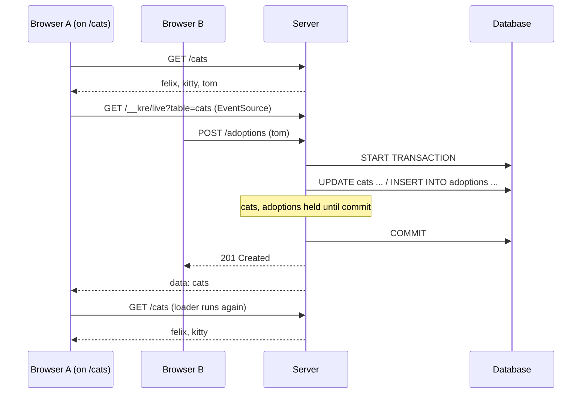

# Live loaders

<p class="lead">A page reloads its data when someone changes a table it reads — with no subscription code in your app. Mark a GET handler with <code>[@@live ["cats"]]</code>, pass the generated table list to the router, and the drivers do the rest. It needs no database triggers, so it works on MariaDB too.</p>

<script setup>
const path = [
  { title: "Write", sub: "A handler runs INSERT / UPDATE / DELETE", tone: "ember" },
  { title: "Driver", sub: "Reads the table name from the SQL text", code: "Kre.Live.wrote", tone: "amber" },
  { title: "Commit", sub: "Inside a transaction, tables wait for the commit", tone: "violet" },
  { title: "SSE", sub: "One event per table on /__kre/live", code: "data: cats", tone: "sky" },
  { title: "Router", sub: "Routes with ~live re-run their loader", tone: "mint" }
]
const stats = [
  { value: "1", label: "attribute", note: "[@@live [ \"cats\" ]] on a GET" },
  { value: "0", label: "lines of subscription code", note: "the router reloads for you" },
  { value: "0", label: "database triggers", note: "drivers see the SQL they run" }
]
</script>

<StatGrid :stats="stats" />

## The whole thing in two lines

On the server, say which tables a GET handler depends on:

<<< @/../examples/shelter/server/cats_controller.ml{3-5}

In the browser, hand the generated list to the route:

<<< @/../examples/shelter/client/routes.mlx{12-19}

That is all. When an admin adds a cat or a member adopts one, every open `/cats` page re-runs its loader and re-renders.

<Flow :steps="path" caption="From a write to a fresh page" />

## Two browsers



## On the server

### `[@@live]`

`[@@live [ "cats"; "users" ]]` goes on a GET handler and lists table names as string literals. Anything else is a build error:

```
Error: [@@live] reloads pages that GET data; f is not a GET
Error: [@@live] lists table names as strings: [@@live [ "cats" ]]
```

The list becomes part of the route's spec, so `kre client` and OpenAPI see it.

### Who publishes

You do not call anything. Both drivers, `kre-db-mariadb` and `kre-db-postgresql`, report the SQL of every statement they run:

- `INSERT`, `UPDATE` and `DELETE` publish their table;
- inside `Db.transaction` or `[@@transactional]` the tables are held and published once after the outer commit; after a rollback they are dropped (see [Transactions](/data/transactions));
- outside a transaction a write publishes immediately.

A store that does not go through SQL — an in-memory service, say — calls `Kre.Live.publish [ "cats" ]` itself.

The shelter's test checks both halves: a successful adoption publishes `adoptions` and `cats`, and a refused one publishes nothing.

### The channel

`Kre.Live.controller` serves `GET /__kre/live?table=cats&table=users` as server-sent events, one `data: <table>` event per change. Mount it next to your controllers:

<<< @/../examples/shelter/bin/main.ml{8-12}

## In the browser

`kre client` writes a `Live` module into each generated client, with the tables of every `[@@live]` route:

```ocaml
(* Tables each [@@live] route reloads on; pass to Router.child ~live. *)
module Live = struct
  let available = [ "cats" ]
  let find_one = [ "cats" ]
  let catalog = [ "cats" ]
end
```

`Kre_client.Router.child ~live` takes that list. While the route is on screen, the router listens to the channel and re-runs the loader on every matching event. Because the list comes from the server's spec, the page cannot drift from the handler it calls.

Outside the router, subscribe directly. `watch` returns the function that unsubscribes:

```ocaml
let stop = Kre_client.Live.watch [ "cats" ] (fun table -> Js.log table) in
(* later *)
stop ()
```

## Checking the list

Forgetting a table in `[@@live]` means silently missing updates. So a `[@@live]` route counts the tables its SQL actually read (`SELECT … FROM … JOIN …`) and compares them with the declared list. What happens next depends on `KRE_ENV`:

| `KRE_ENV` | A table is read but not declared |
| --- | --- |
| `test` | The response becomes a 500 naming the table, so your e2e test fails |
| `dev` or unset | A warning in the log; the response is unchanged |
| anything else | No check, no cost |

The 500 says exactly what to fix:

```
/cats reads users; add it to [@@live]
```

::: tip Declared is a superset
Listing more tables than a route reads is allowed: the page just reloads a little more often. Listing fewer is what the check catches.
:::

## Limits

- **One process.** The event bus lives in memory. Two server processes behind a load balancer do not see each other's writes yet.
- **Tables come from SQL text.** The parser looks at `FROM`, `JOIN`, `INTO` and `UPDATE`. `FROM a, b` sees only `a`.
- **Only the app's writes.** A change made by another program or by hand in a SQL console is not published.
