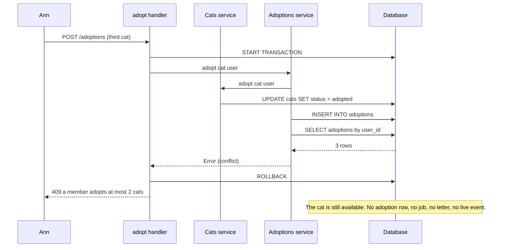

# Transactions

<p class="lead">Put <code>[@@transactional]</code> on a handler and every service it calls writes into one transaction — without passing a connection around. <code>Ok</code> commits, <code>Error</code> or an exception rolls back, and live events and background jobs only see what was committed. The connection is bound to the Lwt context, so everything inside the transaction uses it.</p>

<script setup>
const outcome = [
  { title: "Open", sub: "Borrow a connection from the pool, START TRANSACTION", code: "Db.transaction", tone: "sky" },
  { title: "Bind", sub: "Put the connection in an Lwt key for everything inside", code: "Lwt.with_value", tone: "violet" },
  { title: "Run", sub: "Services call Db.with_conn and get the same connection", tone: "amber" },
  { title: "Decide", sub: "Ok commits; Error or an exception rolls back", tone: "ember" },
  { title: "Publish", sub: "Live events go out only after the commit", code: "Kre.Live", tone: "mint" }
]
const stats = [
  { value: "1", label: "attribute", note: "[@@transactional] on the handler" },
  { value: "0", label: "~conn arguments", note: "services join the open transaction" },
  { value: "409", label: "on a broken rule", note: "and nothing of the request is kept" }
]
</script>

<StatGrid :stats="stats" />

## `Db.transaction`

Every `Kre.Db.S` has a `transaction` function:

```ocaml
val transaction : (conn -> ('a, 'e) result Lwt.t) -> ('a, 'e) result Lwt.t
```

The function you pass returns a `result`. `Ok` commits, `Error` rolls back and is returned as is, and an exception rolls back and is re-raised. The test from the cats example inserts a row, returns an error, and checks the row is gone:

```ocaml
Db.transaction (fun conn ->
    let module Sql = Cats_sql.Make (Kre_db_mariadb.Sql) in
    let%lwt _ = Sql.insert conn ~name:"ghost" ~age:1L ~breed:"persian" in
    Lwt.return_error "abort")
(* Error "abort", and the cats table still has its 3 rows *)
```

<Flow :steps="outcome" caption="What Db.transaction does" />

## Joining: no `~conn` in your services

The interesting part is what happens *inside*. `transaction` puts its connection into an Lwt key. Everything that runs inside sees it:

- `Db.with_conn` in any service returns the transaction's connection instead of borrowing a new one from the pool;
- a nested `Db.transaction` joins the outer one: the outer one decides commit or rollback.

So a service is written the same way whether or not it runs in a transaction:

<<< @/../src/core/db.ml{45-69}

A test in the cats example proves the point: a `with_conn` insert and a nested `transaction` insert, then the outer one returns `Error` — both rows are gone, and nothing was published to live subscribers.

```ocaml
Db.transaction (fun _ ->
    let%lwt _ = Db.with_conn (fun conn -> Sql.insert conn ~name:"ghost" ~age:1L ~breed:"persian") in
    let%lwt inner = Db.transaction (fun conn -> Lwt.map Result.ok (Sql.insert conn ~name:"ghost" ~age:1L ~breed:"persian")) in
    Lwt.return (Result.bind inner (fun _ -> Error "abort")))
(* Error "abort": all rolled back, nothing published *)
```

::: warning The price of joining
Inside a transaction all queries share one connection and run one after another. An `Lwt.async` started inside inherits the connection, so start background work after the transaction — or enqueue a [job](/background/jobs), which is the point of jobs.
:::

## `[@@transactional]` on a handler

In a controller you rarely call `transaction` yourself. Add `[@@transactional]` and a `Kre.Db.S` dependency to the handler:

<<< @/../examples/shelter/server/adoptions_controller.ml{3-8}

The ppx wraps parsing the parameters and calling the handler in `Db.within`, which opens a transaction (or joins an open one). Guards run first, outside the transaction, so a 401 never touches the pool. The `Adoptions` service and the `Cats` service it calls both use plain `Db.with_conn`, and both land in the handler's transaction.

The handler returns `(Adoption.t, Kre.Error.t) result`, and that result is the commit decision: `Ok` commits and becomes 201, `Error` rolls back and becomes a Problem Details response.

### When you need the connection itself

Take a parameter with `[@from Db.tx]` and the ppx hands you the open transaction's connection:

<<< @/../examples/cats/db/batch_controller.ml

Posting a cat with `"note": "fail"` answers 409 and leaves no row behind; any other note answers 204 and keeps it.

::: warning These are compile errors
```
Error: [@@transactional] runs f in a transaction of a Kre.Db.S dependency; add (module Db : Kre.Db.S with type conn = …)
Error: [@@transactional] sees several Kre.Db.S dependencies (A, B); pick one with ~(conn : … [@from A.tx])
Error: [@from Db.tx] reads the open transaction; add [@@transactional] to f
```
:::

## After the commit

Side effects that other people can see must not escape a transaction that rolls back. Kre holds them back:

- **Live events.** The drivers report every `INSERT`, `UPDATE` and `DELETE`. Inside a transaction those tables are collected and published once, after the outer commit; a rollback drops them. See [Live loaders](/data/live).
- **Jobs.** `Jobs.enqueue` writes a row to `kre_jobs` through the same `Db`, so it joins the open transaction. A rollback removes the job; the worker only ever sees committed ones. See [Background jobs](/background/jobs).

## The story: the third adoption

The shelter allows a member to adopt at most two cats. The rule lives in the service, *after* the writes — and that is fine, because the whole request is one transaction:

<<< @/../examples/shelter/server/adoptions_service.ml{12-35}

When Ann adopts her third cat, `Cats.adopt` already marked the cat adopted and the adoption row is already inserted. Then the count says 3, the service returns `Error`, and the transaction rolls everything back:



The shelter's tests check each consequence: the statuses are `201, 201, 409`; the third cat is still listed as available; `/adoptions/mine` returns two adoptions; and exactly two congratulation letters are sent.

Isolation levels and `read_only` are not exposed yet; they will be added when an application needs them.
