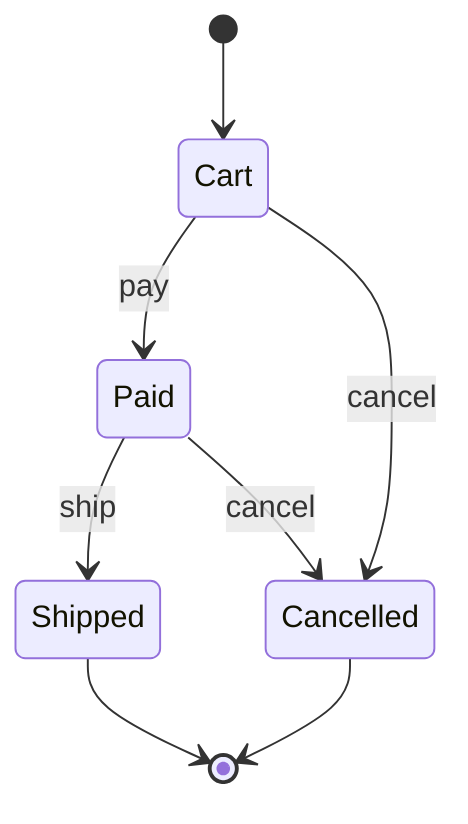
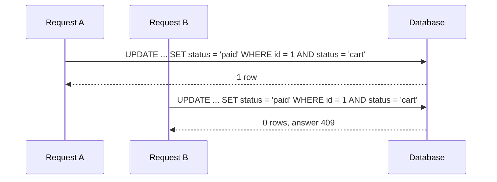

# Workflows

<p class="lead">A state machine in Kre is a variant and a record of <code>function</code>s. <code>[@@deriving workflow]</code> turns it into typed transitions, a checked <code>apply</code>, the list of allowed actions for a state and a Mermaid diagram — and a typo in a state name stops the build instead of surfacing in production.</p>

<script setup>
const generated = [
  { title: "transition", sub: "A variant of transition names", code: "Pay | Ship | Cancel", tone: "ember" },
  { title: "apply", sub: "Checked step, or `Not_allowed", code: "apply Pay Cart", tone: "amber" },
  { title: "allowed", sub: "Which buttons to show for a state", code: "allowed Cart", tone: "mint" },
  { title: "sources", sub: "States a transition starts from, for SQL", code: "sources Cancel", tone: "sky" },
  { title: "workflow_mermaid", sub: "The diagram, as a string", tone: "violet" }
]
const stats = [
  { value: "1", label: "type", note: "states are a plain variant" },
  { value: "0", label: "strings to mistype", note: "transitions are real patterns" },
  { value: "2", label: "targets", note: "native and Melange" }
]
const compare = [
  { topic: "Declaring states", elsewhere: "Symfony: places in YAML or PHP config. AASM: state :paid. Spring Statemachine: an enum plus a configurer", kre: "A variant: type t = Cart | Paid | Shipped | Cancelled" },
  { topic: "Declaring transitions", elsewhere: "Strings or symbols naming the states (from: cart, to: paid)", kre: "[@@transitions { pay = (function Cart -> Paid) }]" },
  { topic: "A typo in a state", elsewhere: "Found at runtime, often on the first request that hits it", kre: "A compile error pointing at the typo" },
  { topic: "A forbidden step", elsewhere: "An exception (Symfony NotEnabledTransitionException, AASM InvalidTransition)", kre: "A value: Error (`Not_allowed (transition, state))" },
  { topic: "Guards on a transition", elsewhere: "Guard expressions, events or callbacks", kre: "None by design; rights and data checks live in the service" },
  { topic: "Diagram", elsewhere: "Symfony: workflow:dump to Graphviz", kre: "workflow_mermaid, a string at compile time" },
  { topic: "In the browser", elsewhere: "Re-implement the rules in JavaScript", kre: "The same type compiles with Melange" }
]
</script>

<StatGrid :stats="stats" />

## An order, start to finish

Here is a whole workflow: four states, three transitions.

<<< @/../docs/examples/order.ml

Drawn out (this is `workflow_mermaid` plus start and end markers):



Each transition is an ordinary `function` from states to a state. `function Cart | Paid -> Cancelled` is a transition from two states; `_ -> …` would be one from any state. The arms are real OCaml patterns over the constructors of `t`, which is why mistakes cannot hide in them.

## What you get

<Flow :steps="generated" caption="What [@@deriving workflow] generates" />

| Name | Type | Use |
| --- | --- | --- |
| `transition` | `Pay \| Ship \| Cancel` | One constructor per field of `[@@transitions]` |
| `transitions` | `transition list` | Every transition, in declaration order |
| `transition_name` | `transition -> string` | `"pay"`, `"ship"`, `"cancel"` |
| `next` | `transition -> t -> t option` | The target state, or `None` |
| `apply` | ``transition -> t -> (t, [> `Not_allowed of transition * t ]) result`` | A checked step |
| `allowed` | `t -> transition list` | What a state can do next — the buttons on a page |
| `sources` | `transition -> t list` | The states a transition starts from |
| `workflow_mermaid` | `string` | A `stateDiagram-v2` for your docs |

The test for the order example shows them at work:

```ocaml
Order.apply Pay Cart                          (* Ok Paid *)
Order.apply Ship Cart                         (* Error (`Not_allowed (Ship, Cart)) *)
Order.apply Cancel Paid                       (* Ok Cancelled *)
List.map Order.transition_name (Order.allowed Cart)   (* ["pay"; "cancel"] *)
List.map Order.to_string (Order.sources Cancel)       (* ["cart"; "paid"] *)
```

`Order.to_string` comes from `[@@deriving dto]` on the same type: the state is a lowercase string in JSON and a plain column in the table.

::: details The generated code
For `type t = Cart | Paid | Cancelled` with `pay` and `cancel`, the ppx writes:

```ocaml
type transition = Pay | Cancel
let transitions : transition list = [Pay; Cancel]
let transition_name : transition -> string =
  function Pay -> "pay" | Cancel -> "cancel"
let next : transition -> t -> t option = function
  | Pay -> (function Cart -> Some Paid | _ -> None)
  | Cancel -> (function Cart | Paid -> Some Cancelled | _ -> None)
let apply transition state =
  Option.to_result ~none:(`Not_allowed (transition, state)) (next transition state)
let allowed state =
  List.filter_map (fun transition -> Option.map (fun _ -> transition) (next transition state)) transitions
let sources transition =
  List.filter_map (fun state -> Option.map (fun _ -> state) (next transition state)) [Cart; Paid; Cancelled]
let workflow_mermaid =
  "stateDiagram-v2\n  Cart --> Paid: pay\n  Cart --> Cancelled: cancel\n  Paid --> Cancelled: cancel\n"
```
No runtime, no registry: a handful of functions you could have written by hand, minus the chance to get them wrong.
:::

## A typo is a compile error

In Symfony, AASM or Spring Statemachine, states are strings, symbols or enum names wired up in configuration, and a misspelt one is found when the code runs. Here the ppx knows the constructors of `t`:

```ocaml
type t = Cart | Paid
[@@deriving workflow]
[@@transitions { pay = (function Cart -> Payd) }]
```

```
File "input.ml", line 3, characters 41-45:
3 | [@@transitions { pay = (function Cart -> Payd) }]
                                             ^^^^
Error: a transition ends in one of the states (Cart, Paid)
```

The same goes for the left side (`a transition starts from states (Cart, Paid), joined with |`). A `when` guard in a transition is also rejected — `a transition is decided by states alone; move the condition into the service` — and so are states that carry data.

## In a service

A transition answers *whether* a step is legal. The service decides *who* may take it and stores the result. `apply` returns a value, so turning a forbidden step into a 409 is one `match` away. A sketch, with `save` standing for your own update:

```ocaml
let pay (order : Order_row.t) =
  match Order.apply Pay order.status with
  | Error (`Not_allowed (transition, state)) ->
      Lwt.return_error
        (Kre.Error.conflict
           (Printf.sprintf "cannot %s an order that is %s"
              (Order.transition_name transition) (Order.to_string state)))
  | Ok next -> save { order with status = next }
```

### Guard the write in SQL

Two requests can read the same state and both decide the step is legal. Close that race in the database: make the `UPDATE` conditional on the state it starts from, and treat zero changed rows as a conflict. The shelter adopts a cat exactly this way:

<<< @/../examples/shelter/server/sql/queries.sql{3-4 sql}

<<< @/../examples/shelter/server/cats_service.ml{72-84}

`sources` gives you the states for that `WHERE` clause when a transition starts from more than one — `Order.sources Cancel` is `[Cart; Paid]`, so the guard becomes `status IN ('cart', 'paid')`.



## In the browser

`[@@deriving workflow]` works under Melange too. Put the type in `shared/` and an `.mlx` page uses the very same `allowed` to decide which buttons to show:

```ocaml
List.map
  (fun transition -> <button> (React.string (Order.transition_name transition)) </button>)
  (Order.allowed order.status)
```

The rules are written once, and the server and the browser cannot disagree about them.

## How it compares

<Compare :rows="compare" left="Symfony / AASM / Spring" right="Kre" />
