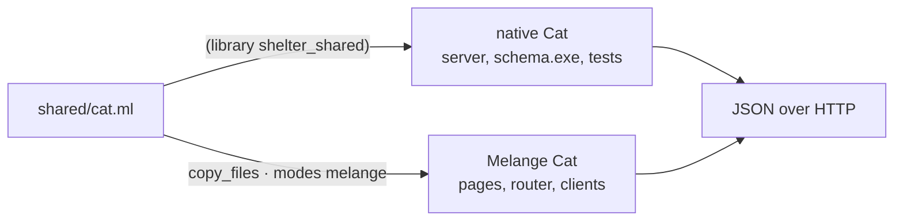
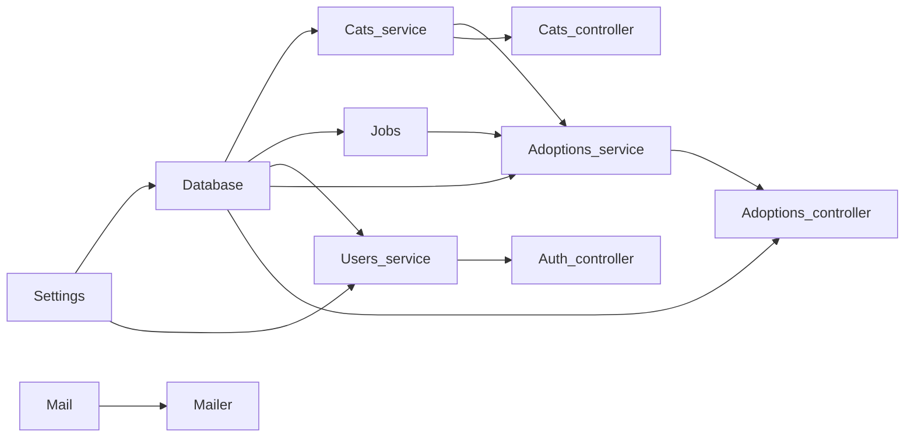

<script setup>
const facts = [
  { value: '4', label: 'layers', note: 'shared, server, client, build time' },
  { value: '2', label: 'compilers, one source', note: 'native and Melange via copy_files#' },
  { value: '0', label: 'runtime containers', note: 'wiring is functor application' }
]

const apiPipeline = [
  { title: 'Controller', sub: 'Handlers with typed parameters', code: '[@@@controller "cats"]', tone: 'ember' },
  { title: 'kre-ppx', sub: 'Generates Paths, spec and register', code: 'val spec : Kre.Spec.t', tone: 'amber' },
  { title: 'spec.json', sub: 'The server binary writes every spec', code: 'main.exe --emit-spec', tone: 'sky' },
  { title: 'kre client', sub: 'A typed Melange module per controller', code: 'cats_client.ml', tone: 'violet' },
  { title: 'OpenAPI 3.1', sub: 'The same spec as a document', code: 'kre openapi', tone: 'mint' }
]

const sqlPipeline = [
  { title: 'Record', sub: 'A type in shared/ or schema/', code: '[@@deriving table]', tone: 'ember' },
  { title: 'schema.exe', sub: 'Prints DDL and CRUD queries', code: 'Kre.Table.schema', tone: 'amber' },
  { title: 'schema.sql', sub: 'The tables, as SQL', code: 'CREATE TABLE cats …', tone: 'sky' },
  { title: 'sqlgg', sub: 'Checks queries against the schema', code: 'queries.sql', tone: 'violet' },
  { title: 'OCaml functions', sub: 'Typed parameters and rows', code: 'Shelter_sql.Make', tone: 'mint' }
]
</script>

# Architecture

<p class="lead">A Kre app is four layers: types shared by both ends, a server on Dream and Lwt, a browser client on Melange and React, and a build step that derives everything that would otherwise be written twice. There is no runtime container and no reflection; the compiler sees the whole application.</p>

<Layers />

<StatGrid :stats="facts" />

## The four layers

| Layer | Runs on | Holds | Depends on |
| --- | --- | --- | --- |
| `shared/` | native **and** Melange | records with `[@@deriving dto]`, refined types, ids, search records | `kre.shared`, jsonkit |
| `server/` | native | controllers, providers, SQL, jobs, mail | `shared`, `kre`, Dream, Lwt |
| `client/` | browser (Melange) | pages in `.mlx`, the router, generated clients | `shared` (JS build), `kre-client` |
| build time | dune rules | ppx output, `spec.json`, `schema.sql`, sqlgg modules, clients | everything above |

The rules between them are strict and enforced by dune `(libraries …)`:

- `shared/` never sees Dream or Lwt. No type in it mentions a monad, so the same file compiles to JavaScript.
- `server/` depends on `shared/`, never on `client/`.
- `client/` depends on the JavaScript build of `shared/` and on `kre-client`, never on the server runtime.
- `bin/main.ml` is the composition root: the only place where the application is assembled.

The framework itself follows the same split. `Kre_shared` (in `src/shared`) is built twice; `Kre` (in `src/core`) is the server runtime; `Kre_client` (in `src/client`) is the browser side. `Kre` does not re-export `Kre_shared`, so you always see which side a name comes from.

## One source, two compilers

A record in `shared/` is the single source of truth. The shelter's `Cat` is a table, a JSON codec with validation and a JSON Schema at once:

<<< @/../examples/shelter/shared/cat.ml

The trick that lets the browser use the very same file is a second dune library that copies the sources with `copy_files#` and builds them in Melange mode:

<<< @/../examples/shelter/shared/melange/dune{dune}

`copy_files#` keeps the original file names in error messages, so a type error in the browser build still points at `shared/cat.ml`. `[%wire]` knows about the copies too: two modules with the same name are treated as one.



Because both ends decode with the same generated `of_json`, a rule like `Name` being 1 to 64 characters has one definition, and the browser and the server cannot disagree about it. See [Validation & types](/guide/validation).

## The build-time pipelines

Two pipelines run on every `dune build`. Neither has a manual step: they are dune rules, so changing a controller or a record regenerates what depends on it, and anything that no longer fits stops the build.

### Controllers to clients and OpenAPI

<Flow :steps="apiPipeline" caption="The controller is the contract" />

1. `kre-ppx` reads each handler's labelled arguments and return type and adds three things to the controller: `Paths` (typed routes), `spec : Kre.Spec.t` and `register`.
2. Started with `--emit-spec FILE` or `--emit-openapi FILE`, `Kre.App.run` writes the specs of every controller it was given and exits without serving.
3. `kre client` turns `spec.json` into a Melange module per controller; `kre openapi` and `kre routes` read the same file.

The shelter wires steps 2 and 3 into its build:

<<< @/../examples/shelter/bin/dune{dune}

<<< @/../examples/shelter/client/dune{dune}

Rename a field in `Cat.t` and the client, the pages that use it and the OpenAPI document all change in the same build. See [Typed client & router](/client/client-router) and [CLI & OpenAPI](/tooling/cli).

### Types to SQL

<Flow :steps="sqlPipeline" caption="The type is the schema; sqlgg checks the SQL" />

`[@@deriving table]` gives each record a `table : Kre.Table.t`. A tiny executable prints them:

```ocaml
let () =
  let tables = [ User.table; Cat.table; Adoption.table; Credential.table ] in
  print_string (Kre.Table.schema Mysql tables)
```

Dune rules then run it to produce `schema.sql` and the CRUD statements, and hand them to sqlgg, which type-checks every query in `queries.sql` against that schema and generates OCaml functions. See [Tables & SQL](/data/database).

## The runtime

The server is **Dream** and **Lwt**, used directly. Kre adds a layer above Dream and hides nothing below it: `Dream.request`, `Dream.response` and `Dream.middleware` appear in Kre signatures as they are, and sessions, CSRF, static files and WebSockets are Dream's own.

| Piece | What it is |
| --- | --- |
| `Kre.App.run` | `Dream.serve` with Kre's router, `~middleware`, `~on_start`, `~on_shutdown`, `~commands` |
| `Kre.App.handler` | the same app as a plain `Dream.handler`, for `Dream.test` or your own `Dream.run` |
| `Kre.Controller.t` | what `register` returns: a spec, routes and middleware |
| `Kre.Route` | everything generated code calls: parsing, guards, serialisation, error mapping |
| `Kre.Error.t` | one error type, rendered as RFC 9457 Problem Details |
| routes | typed, two-way paths: matching on the server, printing in clients |

Handlers return `Lwt.t`. User code writes `let%lwt` and `match%lwt`; generated code uses `Lwt_result` and never depends on `lwt_ppx`. Exceptions raised in a handler are caught once, in `Kre.Route.handle`. Dream is single-domain, so you scale by running several processes behind a load balancer.

## A request, end to end

<RequestPipeline />

Every stage is generated from attributes on the handler, and every stage can stop the request with a typed error. Your function runs only when the path matched, the guards produced their evidence, every argument parsed and the authorization check passed. The details are in [Controllers](/guide/controllers), [Guards & auth](/guide/guards-auth) and [Errors & interceptors](/guide/errors).

## How `[%wire]` assembles the app

The shelter's `bin/main.ml` is the whole composition root:

<<< @/../examples/shelter/bin/main.ml

At build time `[%wire]` scans the project, finds every provider (a module with `module type S` or a `Make` functor) and every controller, sorts them by what they need and applies the functors in that order. This is the graph it produced for the shelter, with arrows from a provider to the modules that receive it:



The order of functor application is the start order, and a cycle cannot be written: it is a compile error. The same graph is served at `/actuator/beans` and `/actuator/beans.mmd`. [Dependency injection](/guide/dependency-injection) covers the rules in full.

::: info Why no container
Kre needs no DI container, injection tokens or forward references, because OCaml's module system already expresses "a service parameterised by a database" with functors. A provider with dependencies is a functor, an interface is a module type, and assembling the app is applying functors in order. The ppx only writes that code for you.
:::
