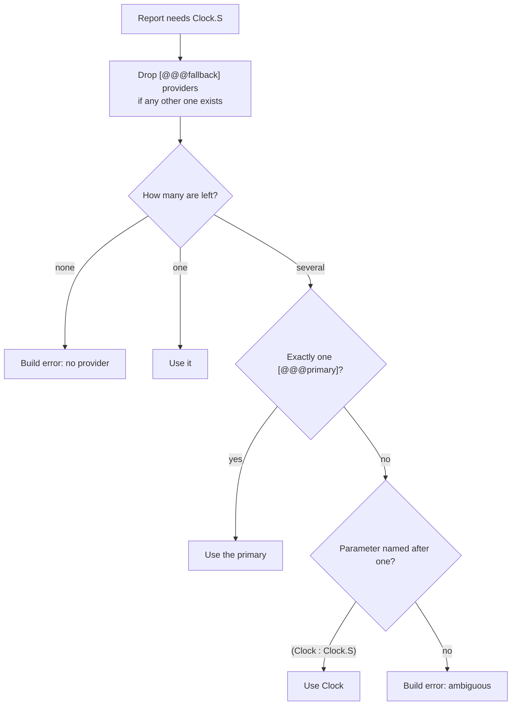
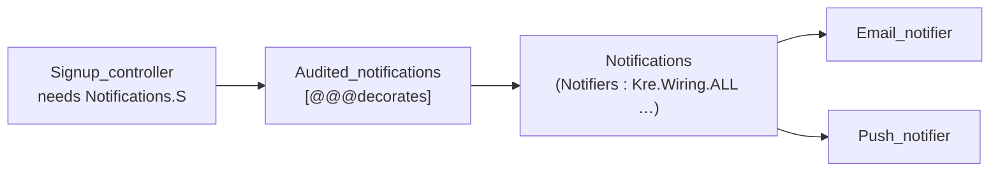
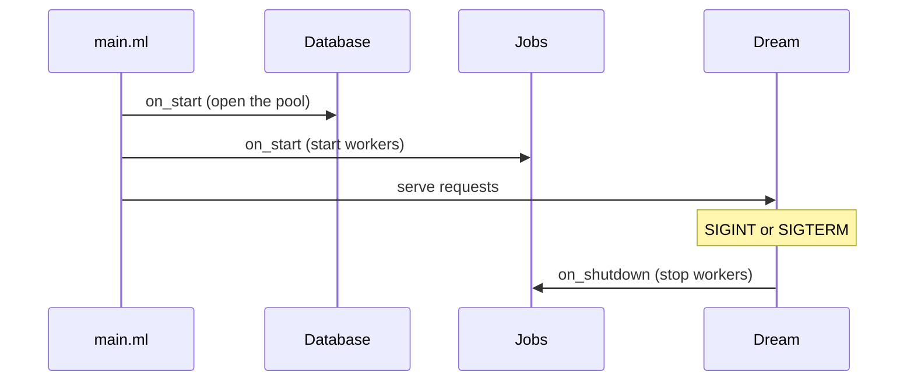
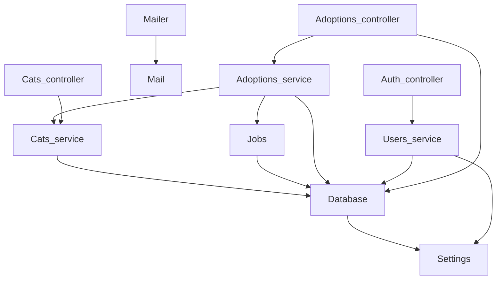

<script setup>
const facts = [
  { value: '3', label: 'provider shapes', note: 'singleton, Make (), Make (Deps)' },
  { value: '3', label: 'ways to compose', note: 'wrap, collect, switch by environment' },
  { value: '0', label: 'containers or reflection', note: 'module types are the tokens' }
]

const wireSteps = [
  { title: 'Scan', sub: 'Every .ml under the app directory, skipping test/ and _build/', tone: 'sky' },
  { title: 'Classify', sub: 'Providers, controllers, everything else ignored', tone: 'violet' },
  { title: 'Resolve', sub: 'Each functor parameter to exactly one provider', tone: 'amber' },
  { title: 'Sort', sub: 'Topologically; a cycle stops the build', tone: 'magma' },
  { title: 'Apply', sub: 'let module X = X.Make (Deps) in …', tone: 'ember' },
  { title: 'Return', sub: 'Kre.Wiring.t: controllers, hooks, health, beans', tone: 'mint' }
]
</script>

# Dependency injection

<p class="lead">In Kre a service is a module, a service with dependencies is a functor, and an interface is a module type. <code>[%wire]</code> finds them all at build time, applies the functors in dependency order and hands you a ready application. A missing provider, an ambiguity or a cycle is a compile error with a file and line.</p>

<StatGrid :stats="facts" />

## Why there is no container

A DI container, injection tokens and runtime reflection exist to say "a cats service, given some database". OCaml says it directly: that is a functor. So Kre maps every DI concept onto what the language already has:

| Concept | Kre |
| --- | --- |
| interface, injection token | `module type S` |
| singleton provider | a module whose `.mli` includes `S` |
| provider with dependencies | `module Make (Db : Kre.Db.S) = …` |
| exports | the `.mli` |
| imports | the functor parameters and dune `(libraries …)` |
| the application module | `bin/main.ml` with `[%wire]` |
| consumer | `(module Cats : Cats_service.S)` on a handler |

## Three shapes of provider

### A singleton: `module type S`

A module that defines `module type S` and implements it at the top level is a singleton. The module itself is the instance. The shelter's configuration is one:

<<< @/../examples/shelter/server/settings.mli

<<< @/../examples/shelter/server/settings.ml

### A fresh instance: `Make ()`

A generative functor with an empty argument creates new state every time it is applied. `include Make ()` gives the module a default instance, and tests can make their own:

<<< @/../examples/cats/server/cats_service.mli

```ocaml
let module Fresh = Cats_service.Make () in
Dream.test (Kre.App.handler [ Cats_controller.register (module Fresh) ])
```

### With dependencies: `Make (Db : …)`

A functor's parameters are its dependencies. The connection pool needs the settings:

<<< @/../examples/shelter/server/database.mli

The adoptions service needs the pool, the cats service and the job queue:

<<< @/../examples/shelter/server/adoptions_service.mli

The **interface** a provider implements is the annotation on its `Make` result (in the `.ml` or the `.mli`), such as `: S` or `: Kre.Job.S`, or otherwise its own `module type S`. When a module only includes something, say so with `[@@@injectable Iface.S]`:

<<< @/../examples/shelter/server/mail.ml

A module that has `module type S` and nothing else is an interface, not a provider.

## Consumers: controllers

Controllers do not declare dependencies anywhere except on the handlers that use them. All module parameters of a file are merged by name and become the parameters of the generated `register`:

<<< @/../examples/shelter/server/adoptions_controller.ml{3-4}

Here `register` takes `(module Adoptions)` and `(module Db)`; `[@@transactional]` uses the `Db` dependency to open the transaction. See [Controllers](/guide/controllers).

## `[%wire]`: compile-time component scan

The composition root is one line:

<<< @/../examples/cats/bin/main.ml{2}

<Flow :steps="wireSteps" caption="What [%wire] does during the build" />

`[%wire]` scans the application directory — the parent of the directory holding `main.ml` — recursively. It skips `test`, `tests`, `_build`, `node_modules` and hidden directories. Copies of one module made by `copy_files#` for Melange are merged by name. To scan only some directories, list them: `[%wire "server"; "db"]`.

| In the file | Role |
| --- | --- |
| `module type S` with a top-level implementation | singleton provider |
| `module Make () = …` | provider, new instance |
| `module Make (Db : Kre.Db.S) (Clock : Clock.S) = …` | provider with dependencies |
| `[@@@controller "…"]` | consumer: handlers' module parameters go to `register` |
| `[@@@gateway "…"]` | consumer, for WebSockets |
| anything else | left alone |

Two things are needed in dune: the ppx on `main.ml`, and a dependency on the sources it reads so the app is re-wired when they change. The modules it finds must be visible from `main`, so the libraries are `(wrapped false)`:

<<< @/../examples/cats/bin/dune{dune}

### What it generates

For a small app with a repository, a clock, a report that needs both and a controller, `[%wire "app"]` expands to plain functor applications:

```ocaml
let app =
  let module Repo = (Repo.Make)() in
  let module Report = ((Report.Make)(Repo))(Clock) in
  Kre.Wiring.make
    ~controllers:[Reports_controller.register (module Report)]
    ~on_start:[Report.on_start] ~on_shutdown:[] ~jobs:[] ~health:[]
    ~commands:[]
    ~beans:[{ Kre.Actuator.name = "Clock"; needs = [] };
            { Kre.Actuator.name = "Repo"; needs = [] };
            { Kre.Actuator.name = "Report"; needs = ["Repo"; "Clock"] };
            { Kre.Actuator.name = "Reports_controller"; needs = ["Report"] }] ()
```

Nothing happens at runtime that you could not have written by hand. The type checker then verifies every application, so a provider whose signature does not match is an ordinary type error.

### What you get back

`[%wire]` returns a `Kre.Wiring.t`:

<<< @/../src/core/wiring.mli{1-11}

The shelter passes every field on:

<<< @/../examples/shelter/bin/main.ml

## Choosing between providers

When exactly one provider implements an interface, it is used. Otherwise `[%wire]` decides in this order:



**`[@@@primary]`** marks the preferred provider. The `cats` example has an in-memory `Cats_service` and a database-backed `Cats_db_service`; the database one wins:

<<< @/../examples/cats/db/cats_db_service.ml{1-4}

**`[@@@fallback]`** marks a default: the provider is created and used only when nothing else implements the interface. A frozen clock for development, replaced automatically once a real one exists:

```ocaml
[@@@fallback]
module Make () : Clock.S = struct let now () = 0. end
```

**The parameter name** settles the rest. `Make (Clock : Clock.S)` picks the provider called `Clock`; `Make (C : Clock.S)` does not pick anything.

## Wrap, collect, switch

Three attributes change what a consumer receives without touching the consumer.



### Wrap: `[@@@decorates I.S]`

A decorator implements an interface by wrapping its other provider. Its `Make` takes that interface; `[%wire]` passes it the original, and everyone else gets the decorator. From the events example:

<<< @/../examples/events/server/audited_notifications.ml

```ocaml
let module Notifications = (Notifications.Make)(…) in
let module Audited_notifications = (Audited_notifications.Make)(Notifications) in
… Signup_controller.register … (module Audited_notifications) …
```

Several decorators of one interface form a chain in file order: the first wraps the original, the next wraps the first, and consumers get the last. A decorator whose `Make` does not take the interface it wraps is a build error.

### Collect: `Kre.Wiring.ALL`

A parameter of type `Kre.Wiring.ALL with type t = (module I.S)` receives every provider of `I.S` as a list of first-class modules:

<<< @/../examples/events/server/notifications.ml

Each notifier is a file that says what it implements:

<<< @/../examples/events/server/email_notifier.ml

Adding a notifier is adding a file. The list leaves out decorators and the provider that asks for it, so a collecting provider can implement the same interface it collects. An empty list is allowed.

### Switch: `[@@@profile "dev"]`

A provider with a profile replaces the provider without one when `KRE_ENV` has that value (`dev` when it is unset):

<<< @/../examples/events/server/quiet_greeting.ml

The choice happens once, at start-up, and only the chosen module is built:

```ocaml
let module Greeting =
  (val (match Kre.Wiring.profile () with
        | "quiet" -> (module Quiet_greeting : Greeting.S)
        | _ -> (module Greeting : Greeting.S))) in
```

Because the result is known only as `Greeting.S`, the providers of a switched interface cannot define `on_start`, `on_shutdown`, `[@@on_event]`, `[@@job]`, `[@@health]` or schedules; put those in a provider of their own. A profile without a provider for the other environments, or two providers with the same profile, is a build error.

## Errors at build time

Every wiring mistake stops `dune build` with a location. These are the exact messages:

::: danger No provider
```text
File "./app/report.ml", line 1, characters 0-49:
Error: Report needs Clock.S, but no provider gives it: add a module with Make or module type S that implements it
```
:::

::: danger Two providers, no tie-breaker
```text
File "./app/report.ml", line 1, characters 0-49:
Error: Report needs Clock.S and 2 providers give it (Clock, Fake_clock); mark one [@@@primary] or name the parameter after one
```
:::

::: danger A cycle
```text
File "./app/clock.ml", line 1, characters 0-47:
Error: dependency cycle: Clock -> Report -> Clock
```
:::

::: danger A decorator that wraps nothing
```text
File "./app/timed_clock.ml", line 1, characters 0-22:
Error: Timed_clock decorates Clock.S, so its Make takes the original: module Make (Inner : Clock.S) = …
```
:::

::: danger A profile with no default
```text
File "./app/test_clock.ml", line 1, characters 0-19:
Error: Test_clock has [@@@profile "test"], but Clock.S has no provider without a profile for the other environments; add one
```
:::

The same checks cover other things `[%wire]` collects: an `[@@on_event]` listener without a `Kre.Events.S` provider is a "no provider" error, and a `[@@cron]` expression is parsed at build time (`[@cron "61 * * * *"]: minute 61 is outside 0-59`).

## Lifecycle hooks

A provider that defines `on_start` or `on_shutdown` (and exposes it in its signature) gets them called: `on_start` in dependency order before the server accepts requests, `on_shutdown` in reverse order after SIGINT or SIGTERM.

The shelter's database reports its health:

```ocaml
let ping () =
  Lwt.catch
    (fun () ->
      with_conn (fun conn ->
          Lwt.map (fun _ -> Ok ()) (Kre_db_mariadb.Driver.strings conn "SELECT 1")))
    (fun exn -> Lwt.return_error (Printexc.to_string exn))
[@@health "db"]
```



`[@@health "db"]` marks a provider function of type `unit -> (unit, string) result Lwt.t`. `[%wire]` collects them into `app.health`, and `/actuator/health` answers `200 up` or `503 down` with the reason. Without `[%wire]`, the same hooks are plain arguments: `Kre.App.run ~on_start ~on_shutdown`.

## The graph, live

`app.beans` lists the providers in start order, then the controllers, each with what it received. `Kre.Actuator.make ~beans:app.beans` serves it as JSON at `/actuator/beans` and as a mermaid diagram at `/actuator/beans.mmd`. Here is the shelter's, exactly as `beans.mmd` prints it (an arrow points from a module to what it needs):



The graph is computed by the compiler, so it is exactly what was applied. See [Actuator & profiler](/tooling/observability).

## Scopes and substitutes

| You need | Kre |
| --- | --- |
| one shared instance | a module or an applied functor |
| a new value on every use | a plain function |
| per-request state | a `Dream.field` set by middleware and read by a `[@guard]`; services take it as a function argument, so nothing "bubbles" |
| a substitute implementation | another module with the same signature |
| a value built at startup, possibly async | ordinary code in `main.ml` before `Kre.App.run`, or an `on_start` hook |
| a configurable module | a functor over a config module: `Kre.Db.Make (Driver) (struct let url = … let size = 4 end)` |

Substituting by hand is just passing a different module:

<<< @/../docs/examples/composition.ml
