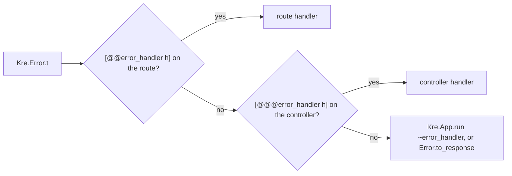
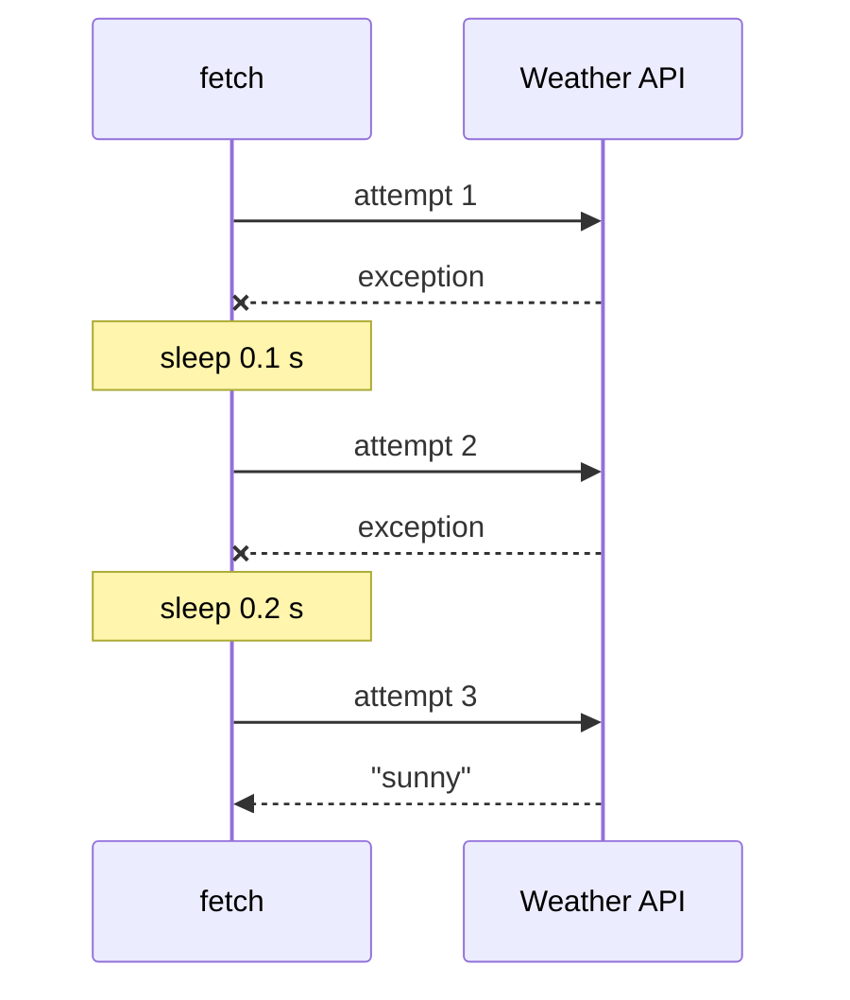

# Errors & interceptors

<p class="lead">Every failure in Kre is one value, <code>Kre.Error.t</code>, and it always leaves the server as RFC 9457 Problem Details. Handlers return errors as data, filters turn them into responses, and interceptors wrap the typed result of a handler.</p>

<script setup>
const lifecycle = [
  { title: 'Guards', sub: '[@@@guards], [@@guards]', tone: 'ember' },
  { title: 'Interceptors', sub: 'around: parameters and handler', code: '[@@intercept]', tone: 'violet' },
  { title: 'Timeout', sub: '504 if the handler is late', code: '[@@timeout 5.0]', tone: 'amber' },
  { title: 'Handler', sub: "Ok value, Error e, or an exception", tone: 'mint' },
  { title: 'Error handler', sub: 'Route, then controller, then app', code: '~error_handler', tone: 'sky' }
]
</script>

| At a glance | |
| --- | --- |
| Error type | `Kre.Error.t`, 4xx and 5xx only |
| Wire format | RFC 9457, `application/problem+json` |
| Error handler levels | route, controller, app |

## `Kre.Error.t`

An error is a status, a short machine `code`, a human `detail` and optional extra members. The status type only admits client and server errors, so a "200 error" cannot be written:

<<< @/../src/core/error.mli

The constructors cover the common cases and fix the code for you:

| Constructor | Status | `code` |
| --- | --- | --- |
| `bad_request` | 400 | `bad_request` |
| `unauthorized` | 401 | `unauthorized` |
| `forbidden` | 403 | `forbidden` |
| `not_found` | 404 | `not_found` |
| `conflict` | 409 | `conflict` |
| `unprocessable` | 422 | `validation` |
| `internal` | 500 | `internal` |

For anything else, use `make ~status ~code detail`. The `type` URI defaults to `urn:kre:error:<code>` and can be overridden with `~type_`; `~extensions` become extra top-level members of the JSON.

A `GET /cats/7` for a missing cat answers:

```json
{
  "type": "urn:kre:error:not_found",
  "title": "Not Found",
  "status": 404,
  "detail": "cat",
  "instance": "/cats/7"
}
```

`instance` is the request target. A 422 adds an `errors` array with one entry per bad field; see [Validation & types](/guide/validation).

## Returning errors from handlers

The usual way is to say so in the return type. A handler of type `(T.t, Kre.Error.t) result Lwt.t` answers `Ok` with the value and `Error e` with the problem:

<<< @/../examples/cats/server/cats_controller.ml{20-27 ocaml}

When you are deep inside code that returns a plain `'a Lwt.t`, `Kre.Error.fail e` raises `Kre.Error.E e`; the route catches it and answers with that error. Any other exception becomes a `500 internal` and is written to the log with the request — the details never reach the client.

<Flow :steps="lifecycle" caption="Where errors can come from, and where they end up" />

## Error handlers (exception filters)

An error handler decides how an error becomes a response:

```ocaml
type handler = Dream.request -> Kre.Error.t -> Dream.response Lwt.t
```

The default is `Kre.Error.to_response`, which writes Problem Details. A handler that renders HTML pages for browsers and keeps Problem Details for everything else:

<<< @/../docs/examples/error_pages.ml

You can attach a handler at three levels. The most specific one wins:



The app level also handles requests that match no route at all: they arrive as `Kre.Error.not_found`. A controller that uses all three:

<<< @/../docs/examples/legacy_controller.ml

- `[@@@error_handler Error_pages.handler]` renders the whole controller's errors as pages: `GET /legacy/gone` gets the HTML 404.
- `[@@error_handler Kre.Error.to_response]` on `plain` opts that one route back into Problem Details.
- `[@@timeout 0.05]` on `slow` answers `504` with code `timeout` when the handler takes longer. The payload is seconds as a float; `[@@timeout 5]` is a compile error that tells you to write `5.0`.

## Interceptors

An interceptor wraps the handler's **typed** result. It runs after the unit guards and around parameter parsing and the handler:

<<< @/../src/core/interceptor.mli

The `'a.` in `around` makes it polymorphic: one interceptor works for every handler, and it cannot change the type of the result. It can time the call, log it, replace an error, or cut it short.

| Interceptor | Does |
| --- | --- |
| `logging` | Logs method, path, outcome and duration |
| `timeout s` | Answers 504 when the handler does not finish in `s` seconds |
| `map_error f` | Rewrites the error |
| `tap f` | Runs `f request` before the handler; for counters and auditing |
| `chain [ a; b ]` | One interceptor from many; `a` is the outermost |

Attach them with `[@@intercept [ … ]]` on a handler or `[@@@intercept [ … ]]` on the whole controller:

<<< @/../docs/examples/audit_controller.ml

`hidden` turns a 404 into a 403 so that `GET /audit/2` does not reveal whether secret number 2 exists. `counted` counts calls, and every route of the file is logged.

::: tip Interceptor or middleware?
An interceptor sees the typed result and never the serialized response. Work on the finished response — adding a header, caching bytes, wrapping the body — belongs in a `Dream.middleware`.
:::

This middleware adds a `Server-Timing` header to every response, which no interceptor could do:

<<< @/../docs/examples/timing.ml

## Retries: `[@@retry n]` on any function

`[@@retry n]` goes on any function — a service, a client call, a handler. The ppx wraps the body in `Kre.Retry.run`:

```ocaml
let fetch ~city () : string Lwt.t = Weather.get city
[@@retry 3] [@@backoff 0.1]
```

becomes

```ocaml
let fetch ~city () : string Lwt.t =
  Kre.Retry.run ~backoff:0.1 ~attempts:3 (fun () -> Weather.get city)
```

If the call raises, it runs again, up to `n` attempts in total. `[@@backoff s]` is the first pause in seconds; each next pause is twice as long. After the last attempt the exception goes on as it was.



Only exceptions are retried. An `Error` in a `result` is a real answer — a 404 or a 409 — and asking again will not change it. Without the ppx, call `Kre.Retry.run ~attempts:3 (fun () -> …)` directly.

::: warning The ppx checks where it goes
- `let fetch = Weather.get [@@retry 3]` fails: `[@@retry] repeats a call; put it on a function: let f x = … [@@retry 3]`.
- `[@@retry "three"]` fails: `[@@retry] takes the number of attempts: [@@retry 3]`.
- `[@@backoff 0.1]` alone fails: `[@@backoff] sets the pause between retries; add [@@retry 3]`.
:::

To see these errors from the other side, read [Testing](/tooling/testing): `Kre_client.Error` decodes the same Problem Details in typed tests and in the browser.
