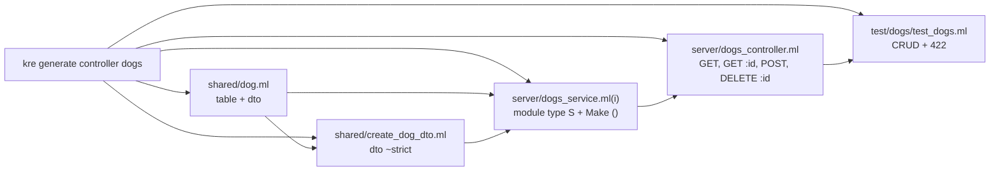

<script setup>
const loop = [
  { title: 'kre new', sub: 'A project that builds and passes its own test', code: 'kre new demo', tone: 'ember' },
  { title: 'generate', sub: 'Type, DTO, service, controller and a test', code: 'kre generate controller dogs', tone: 'amber' },
  { title: 'build', sub: 'ppx writes routes, codecs and the spec', code: 'dune build', tone: 'sky' },
  { title: 'test', sub: 'Requests through Dream.test, no sockets', code: 'dune test', tone: 'mint' },
  { title: 'run', sub: 'Dream on port 8080', code: 'dune exec bin/main.exe', tone: 'violet' }
]

const stats = [
  { value: '12', label: 'files from kre new', note: 'shared, server, bin, test' },
  { value: '7', label: 'files per resource', note: 'type, DTO, service, controller, test' },
  { value: '5', label: 'field types', note: 'string, int, float, bool, time' }
]

const compare = [
  { topic: 'New project', elsewhere: 'nest new · rails new · spring init', kre: 'kre new demo' },
  { topic: 'A resource', elsewhere: 'nest g resource · rails g scaffold', kre: 'kre generate controller dogs name:string' },
  { topic: 'Registering it', elsewhere: 'Added to a module or found by scanning', kre: 'One line in bin/main.ml, or [%wire] finds it' },
  { topic: 'First test', elsewhere: 'A spec file with mocks you fill in', kre: 'A CRUD test that already passes' },
  { topic: 'Overwriting files', elsewhere: 'Prompts or --force', kre: 'Never: if one file exists, nothing is written' }
]
</script>

# Getting started

<p class="lead">Install Kre into a local opam switch, create a project with <code>kre new</code>, add a resource with <code>kre generate</code>, and you have a typed JSON API with a passing test in about a minute.</p>

<Flow :steps="loop" caption="The loop you will repeat every day" />

## Install

Kre targets **OCaml 5.5**: modular explicits like `(module Cats : Cats_service.S)` are what make handler dependencies work. Everything lives in one opam switch, because Melange 7 is built for the same compiler, so the server and the browser share one toolchain.

Clone the repository and create a local switch inside it:

```sh
git clone https://github.com/jongleber/forge.git
cd kre
opam switch create . 5.5.1 --deps-only --with-test   # a local switch in _opam/
eval $(opam env --switch=. --set-switch)
dune build
```

`dune build` compiles the runtime (`kre`, `kre.shared`), the ppx (`kre-ppx`), the browser library (`kre-client`) and the `kre` command-line tool. Install them into the switch so your projects can find them:

```sh
dune install
kre --help
```

::: tip Check the toolchain
`dune test` in the repository runs the whole suite: ppx expect tests, the runtime, both example apps and the scaffold test that creates a project from scratch. If it passes, your switch is ready.
:::

## Create a project

```sh
kre new demo
```

`kre new` prints every file it writes:

```text
created demo/.gitignore
created demo/.ocamlformat
created demo/bin/dune
created demo/bin/main.ml
created demo/dune-project
created demo/server/dune
created demo/server/health_controller.ml
created demo/shared/dune
created demo/shared/health.ml
created demo/shared/melange/dune
created demo/test/dune
created demo/test/test_health.ml
```

<StatGrid :stats="stats" />

### What is inside

```text
demo/
├── dune-project            (lang dune 3.21) + melange
├── shared/                 types for both ends of the wire
│   ├── dune                library "shared", native
│   ├── health.ml           type t = { status; service } [@@deriving dto]
│   └── melange/
│       └── dune            library "shared_js": the same files, built for JS
├── server/
│   ├── dune                library "server", preprocessed by kre-ppx
│   └── health_controller.ml
├── bin/
│   ├── dune
│   └── main.ml             the composition root: what the app serves
└── test/
    ├── dune
    └── test_health.ml      GET /health through Dream.test
```

The split is the whole architecture in miniature. `shared/` holds records that both the server and the browser compile. `server/` holds controllers and services. `bin/main.ml` decides what runs. See [Architecture](/guide/architecture) for the full picture.

The shared type is one line:

```ocaml
open Jsonkit.Primitives

type t = { status : string; service : string } [@@deriving dto]
```

The controller is one function. Its return type, `Health.t Lwt.t`, tells the ppx to answer with JSON:

```ocaml
[@@@controller "health"]

let status () : Health.t Lwt.t =
  Lwt.return { Health.status = "up"; service = "demo" }
[@@get]
```

And `bin/main.ml` is the application — a list of controllers handed to Dream:

```ocaml
let () =
  Kre.App.run ~middleware:[ Dream.logger ]
    [ Health_controller.register () ]
```

`shared/melange/dune` is how one set of sources becomes two libraries. It copies the `.ml` files from the parent directory and builds them with Melange:

```dune
(library
 (name shared_js)
 (wrapped false)
 (modes melange)
 (libraries kre-client.shared jsonkit-melange)
 (preprocess
  (pps melange.ppx jsonkit-melange.ppx kre-ppx -- -melange)))

(copy_files#
 (files ../*.ml))
```

## Build, test, run

```sh
cd demo
dune build
dune test
```

```text
  [OK]          health          0   GET /health.
```

The test never opens a socket. `Kre.App.handler` turns the controller list into an ordinary `Dream.handler`, and `Dream.test` calls it with a fake request:

```ocaml
let () =
  let app = Dream.test (Kre.App.handler [ Health_controller.register () ]) in
  Alcotest.run "demo"
    [
      ( "health",
        [
          Alcotest.test_case "GET /health" `Quick (fun () ->
              let response = app (Dream.request ~target:"/health" "") in
              Alcotest.(check (pair int string))
                "up"
                (200, {|{"status":"up","service":"demo"}|})
                ( Dream.status_to_int (Dream.status response),
                  Lwt_main.run (Dream.body response) ));
        ] );
    ]
```

Now start the server. `Kre.App.run` is `Dream.serve` with Kre's router, so it listens on Dream's default port:

```sh
dune exec bin/main.exe
curl localhost:8080/health
# {"status":"up","service":"demo"}
```

## Generate a resource

`kre generate controller` is `rails generate scaffold` and `nest g resource` in one: a type, a creation DTO, an in-memory service, a CRUD controller and a test. Fields are `name:type`, where the type is `string`, `int`, `float`, `bool` or `time`. With no fields you get `name:string`.

```sh
kre generate controller dogs name:string age:int born:time good:bool
```

```text
created ./server/dogs_controller.ml
created ./shared/create_dog_dto.ml
created ./shared/dog.ml
created ./test/dogs/dune
created ./test/dogs/test_dogs.ml
created ./server/dogs_service.ml
created ./server/dogs_service.mli
```



### The entity

`shared/dog.ml` is ready to become a table: an opaque id, a primary key, and string fields with a size and a minimum length. `born:time` becomes `Kre_shared.Time.t`, which travels as an ISO 8601 string.

```ocaml
open Jsonkit.Primitives

module Id = Kre_shared.Id.Make ()

type t = {
  id : Id.t; [@primary] [@auto] [@column int]
  name : string; [@size 255] [@validate min_length 1]
  age : int;
  born : Kre_shared.Time.t;
  good : bool;
}
[@@deriving table ~name:"dogs", dto]
```

The creation DTO has no id, and `~strict` rejects unknown fields:

```ocaml
open Jsonkit.Primitives

type t = {
  name : string; [@validate min_length 1]
  age : int;
  born : Kre_shared.Time.t;
  good : bool;
}
[@@deriving dto ~strict]
```

### The service and the controller

The service interface is a `module type S`, plus a generative `Make ()` so each test can have its own state. Later you replace it with a database-backed `Make (Db : Kre.Db.S …)` and the controller does not change — see [Dependency injection](/guide/dependency-injection).

```ocaml
(** The dogs provider. *)
module type S = sig
  val add : Create_dog_dto.t -> Dog.t Lwt.t
  val find_all : unit -> Dog.t list Lwt.t
  val find : Dog.Id.t -> Dog.t option Lwt.t
  val remove : Dog.Id.t -> unit Lwt.t
end

(** A provider with its own state, e.g. one per test. *)
module Make () : S

include S
```

The controller takes the service as a module argument. Return types do the rest: `option` becomes 404, `unit` becomes 204.

```ocaml
[@@@controller "dogs"]

let find_all (module Dogs : Dogs_service.S) () : Dog.t list Lwt.t =
  Dogs.find_all ()
[@@get]

let find_one (module Dogs : Dogs_service.S) ~(id : Dog.Id.t) :
    Dog.t option Lwt.t =
  Dogs.find id
[@@get ":id"]

let create (module Dogs : Dogs_service.S) ~(body : Create_dog_dto.t) :
    Dog.t Lwt.t =
  Dogs.add body
[@@post] [@@status 201]

let remove (module Dogs : Dogs_service.S) ~(id : Dog.Id.t) () : unit Lwt.t =
  Dogs.remove id
[@@delete ":id"]
```

### The test

The generated test creates a fresh service, registers the controller with it and walks through create, read, remove and a bad body:

```sh
dune build
dune test
```

```text
  [OK]          crud          0   create, read, remove.
  [OK]          crud          1   invalid body is 422.
```

| Request | Expected |
| --- | --- |
| `POST /dogs` with a sample body | `201` and the dog with `"id":1` |
| `GET /dogs/1` | `200` and the same dog |
| `DELETE /dogs/1` | `204`, empty body |
| `GET /dogs/1` again | `404` |
| `POST /dogs` with `{}` | `422` with Problem Details |

::: warning Generators never overwrite
If any file the generator would write already exists, it writes nothing and exits:

```text
kre: ./server/cats_controller.ml already exists; nothing was written
```

A field with an unknown type is rejected the same way:

```text
kre: wings:triple: a field is name:type with type string, int, float, bool or time
```
:::

### Serve it

`kre new` keeps `bin/main.ml` explicit, so you add the new controller yourself. The compiler checks that you pass a module with the right signature:

```ocaml
let () =
  Kre.App.run ~middleware:[ Dream.logger ]
    [
      Health_controller.register ();
      Dogs_controller.register (module Dogs_service);
    ]
```

```sh
dune exec bin/main.exe
curl -X POST localhost:8080/dogs \
  -d '{"name":"rex","age":3,"born":"2023-05-01T00:00:00.000Z","good":true}'
```

::: details Let [%wire] do it instead
In a larger app you stop listing controllers by hand. Replace the list with `[%wire]`, which scans the project at build time, applies every provider functor and registers every controller:

```ocaml
let () =
  let app = [%wire] in
  Kre.App.run ~on_start:app.on_start ~on_shutdown:app.on_shutdown
    app.controllers
```

`bin/dune` then needs the ppx and a dependency on the sources it scans:

```dune
(executable
 (name main)
 (libraries server kre dream)
 (preprocess
  (pps kre-ppx))
 (preprocessor_deps
  (source_tree ..)))
```
:::

### Other generators

| Command | Writes |
| --- | --- |
| `kre generate controller cats [field:type …]` | type, DTO, service, controller, test |
| `kre generate service cats` | `server/cats_service.ml` and `.mli` with `module type S` |
| `kre generate dto signup` | `shared/signup_dto.ml` |

## How it compares

<Compare :rows="compare" left="Nest / Rails / Spring" right="Kre" />

## Next steps

::: tip Learn the pieces
- [Architecture](/guide/architecture) — the four layers and what happens at build time.
- [Controllers](/guide/controllers) — every kind of parameter and return type.
- [Dependency injection](/guide/dependency-injection) — swap the in-memory service for a database one.
- [Tables & SQL](/data/database) — turn `[@@deriving table]` into a schema and typed queries.
:::

::: info See it all at once
[The shelter tour](/reference/shelter) is a complete app built the same way, with auth, transactions, live pages and jobs.
:::
