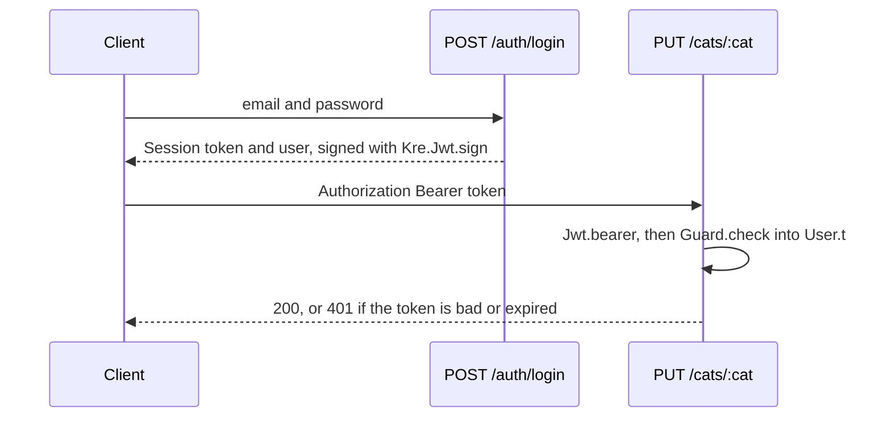

# Guards & auth

<p class="lead">In Kre a guard does not answer yes or no. It reads the request and returns evidence — the signed-in <code>User.t</code>, or an <code>Auth.Admin.t</code> that only the auth module can make. A handler that asks for that evidence in its signature cannot be reached without it, and the compiler checks every call site.</p>

<script setup>
const order = [
  { title: 'Route match', sub: 'Path segments parse or the answer is 404', tone: 'magma' },
  { title: 'Controller guards', sub: 'Every unit guard of the file', code: '[@@@guards]', tone: 'ember' },
  { title: 'Handler guards', sub: 'Unit guards of this route', code: '[@@guards]', tone: 'amber' },
  { title: 'Parameters', sub: 'Left to right: evidence, loaded entities, query, body', code: '[@guard] [@load]', tone: 'violet' },
  { title: 'Authorize', sub: 'A closure over the typed arguments', code: '[@@authorize]', tone: 'sky' },
  { title: 'Handler', sub: 'Runs with proof in hand', tone: 'mint' }
]
const stats = [
  { value: '1', label: 'type for every guard', note: "'a Kre.Guard.t" },
  { value: '401 / 403', label: 'unauthorized / forbidden', note: 'as Problem Details' },
  { value: '0', label: 'runtime role strings', note: 'roles are types' }
]
const compare = [
  { topic: 'A guard', elsewhere: 'A class implementing CanActivate that returns a boolean', kre: "A function Dream.request -> ('a, Kre.Error.t) result Lwt.t" },
  { topic: 'Getting the user', elsewhere: 'req.user, filled by Passport, typed as any', kre: 'A parameter ~(user : (User.t [@guard Auth.current]))' },
  { topic: 'Roles', elsewhere: '@Roles("admin") metadata and a RolesGuard (Nest); @PreAuthorize("hasRole(...)") (Spring)', kre: 'An abstract evidence type, Auth.Admin.t' },
  { topic: 'Ownership checks', elsewhere: 'Voters (Symfony), @PreAuthorize with SpEL (Spring), policies (Laravel)', kre: '[@@authorize fun ~user ~cat -> ...], type-checked' },
  { topic: 'Loading the entity', elsewhere: 'ParamConverter / route model binding', kre: '~(cat : (Cat.t [@load Cats.find])), 404 if missing' },
  { topic: 'JWT', elsewhere: '@nestjs/jwt + passport-jwt', kre: 'Kre.Jwt.sign, verify and bearer, HS256 built in' },
  { topic: 'Security headers, CORS, throttling', elsewhere: 'helmet, enableCors, @nestjs/throttler', kre: 'Secure_headers, Cors, Rate_limit middleware' }
]
</script>

<StatGrid :stats="stats" />

## A guard is a function

```ocaml
type 'a t = Dream.request -> ('a, Kre.Error.t) result Lwt.t
```

That is the whole of `Kre.Guard.t`. A guard that fails returns a `Kre.Error.t`, usually `Kre.Error.unauthorized` (401) or `Kre.Error.forbidden` (403), and that error becomes the response. A guard that succeeds returns a value, and what that value is decides how useful the guard is.

The weakest guard returns `unit`: it only says "go on". The strongest returns a value of a type that nobody else can construct. Here is a small example from the docs, reading roles from headers to keep it short:

<<< @/../docs/examples/roles.ml

`Admin.t` is abstract outside its module, and only `of_header` makes one. So `admin` is the only way to get an `Admin.t` in the whole program.

## Three ways to attach a guard

| Where | Attribute | Guard type | What the handler gets |
| --- | --- | --- | --- |
| Every route of the controller | `[@@@guards [ g1; g2 ]]` | `unit Kre.Guard.t` | nothing, only the check |
| One route | `[@@guards [ g ]]` | `unit Kre.Guard.t` | nothing, only the check |
| One parameter | `~(x : (T.t [@guard g]))` | `T.t Kre.Guard.t` | the evidence, typed |

`[@from g]` is a synonym for `[@guard g]`, handy when the "guard" is just an extractor such as the client IP. A guarded parameter never appears in the OpenAPI document or in the generated client: it comes from the request, not from the caller's arguments.

<<< @/../docs/examples/admin_controller.ml

`purge` cannot be called without a `Roles.Admin.t`, and only `Roles` can create one. If you delete the guard from the parameter, the handler no longer compiles against its own type.

## Building guards: `Kre.Guard`

You rarely write a guard by hand. `Kre.Guard` composes them:

| Function | Type | Use |
| --- | --- | --- |
| `header name` | `string t` | A required header |
| `session key` | `string t` | A field of the Dream session |
| `field f ~missing` | `'a t` | A `Dream.field` set by earlier middleware |
| `map f g` | `'b t` | Transform the evidence |
| `check f g` | `'b t` | Refine it: `f : 'a -> ('b, Kre.Error.t) result` |
| `both g1 g2` | `('a * 'b) t` | Require two |
| `optional g` | `'a option t` | Never fails; `None` when `g` would |

`check` is the one to remember. It turns weak evidence into strong evidence: claims into a user, a user into an admin.

## JWT

`Kre.Jwt` signs and verifies HS256 tokens. The signature is compared in constant time.

```ocaml
val sign :
  secret:string -> ?now:float -> ?extra:(string * Jsonkit.t) list ->
  expires_in:float -> string -> string

val verify :
  secret:string -> ?now:float -> string ->
  (claims, [> `Jwt of Malformed | Bad_signature | Expired ]) result

val bearer : secret:string -> claims Kre.Guard.t
```

`claims` has a `subject`, an `expires` time and `extra`, the other members of the payload. `bearer` is a ready guard: it reads `Authorization: Bearer …`, verifies the token and returns the claims. With `check`, a role is one line:

<<< @/../docs/examples/token_auth.ml



Password hashing is your application's job; use argon2 or bcrypt in the users service.

## The shelter: a real auth module

The shelter app keeps everything about identity in one module. Its interface is the policy:

<<< @/../examples/shelter/server/auth.mli

`Admin.t` is abstract, so outside `Auth` it is a type with no values. The implementation puts the whole user in the token at login, reads it back with `Kre_shared.Json.parse`, and refines the user into an admin by matching on the role variant:

<<< @/../examples/shelter/server/auth.ml

Three things to notice:

- `current` is `Kre.Jwt.bearer` refined by `check` into a `User.t`. A token without a valid user is a 401.
- `admin` is `current` refined again. A member gets a 403; an admin gets `Admin.Admin`, which only this file can write.
- `owner_or_admin` is not a guard. It needs the cat, which the request alone does not give you. That is what `[@@authorize]` is for.

The login side is a plain controller. `Auth.session` signs the token:

<<< @/../examples/shelter/server/auth_controller.ml

## Authorization over typed arguments

A guard sees only the request. An ownership check needs the parsed arguments: who is asking, and for which record. `[@@authorize]` takes a literal function whose labels name the handler's arguments; it runs after every parameter is parsed and before the handler body.

<<< @/../examples/shelter/server/cats_controller.ml{24-28 ocaml}

Read `rename` from left to right:

1. `~user:(_ : (User.t [@guard Auth.current]))` — the bearer token becomes a `User.t`, or the request ends with 401.
2. `~(cat : (Cat.t [@load Cats.find]))` — the `:cat` path segment is parsed as a `Cat.Id.t` and `Cats.find` loads the cat. A missing cat is a 404; your handler never sees an `option`.
3. `~(body : Rename_dto.t)` — the body is parsed, or the request ends with 422.
4. `[@@authorize fun ~user ~cat -> Auth.owner_or_admin ~user cat]` — gets the same `user` and `cat`, typed. `Error e` becomes the response, here a 403.

The closure must return `(unit, Kre.Error.t) result Lwt.t`; there is no `bool` version. A label the handler does not have is a compile error, and the closure can use the handler's module dependencies by name.

The full controller shows all three styles side by side — a public route, an admin-only route with evidence, and an owner-or-admin route with `[@@authorize]`:

<<< @/../examples/shelter/server/cats_controller.ml

## The order of checks

<Flow :steps="order" caption="What runs before a handler, in order; the first error is the response" />

Unit guards run before interceptors and before any parameter is parsed, so a request without a token never pays for parsing a body. Then the labelled parameters run left to right — `[@guard]`, `[@load]`, query and body, in the order you wrote them — and the first `Error` stops the chain. `[@@authorize]` comes last, when every argument it may need exists. Put the cheapest, most general check first: in `rename`, the user is checked before the cat is loaded.

::: tip The smaller example
`docs/examples/notes_controller.ml` has the same shape in a dozen lines: `~(user : (string [@guard Roles.user]))`, `~(id : int)` and `[@@authorize fun ~user ~id -> owns ~user ~id]`.
:::

## Security middleware

Headers, CORS and rate limiting are not guards: they act on every response, including errors. They are ordinary `Dream.middleware` values, attached globally with `Kre.App.run ~middleware`, per controller with `[@@@use [ … ]]`, or per route with `[@@use [ … ]]`.

<<< @/../docs/examples/hardened.ml

| Module | Does | Borrowed from |
| --- | --- | --- |
| `Kre.Secure_headers` | Sets `Content-Security-Policy`, `X-Content-Type-Options`, `X-Frame-Options`, `Referrer-Policy`, `Cross-Origin-Opener-Policy`. HSTS only with `~transport:(Https_only { max_age })`. A header the handler set is kept. | helmet |
| `Kre.Cors` | `~origins` is `Any` or `Only [ … ]`; `~credentials:Include` for cookies; preflight `OPTIONS` answers 204 without reaching a handler | `app.enableCors` |
| `Kre.Rate_limit` | A fixed window per key (the client IP by default, or `~key`); over the limit is a 429 Problem Details with `Retry-After` | `@nestjs/throttler` |

::: warning One process
`Rate_limit` keeps its counters in memory. Behind several processes, each one counts on its own.
:::

## How it compares

<Compare :rows="compare" left="NestJS / Spring / Symfony" right="Kre" />

Errors from guards, `[@@authorize]` and parsing all travel as `Kre.Error.t`. [Errors & interceptors](/guide/errors) shows how to render them and how to wrap handlers.
