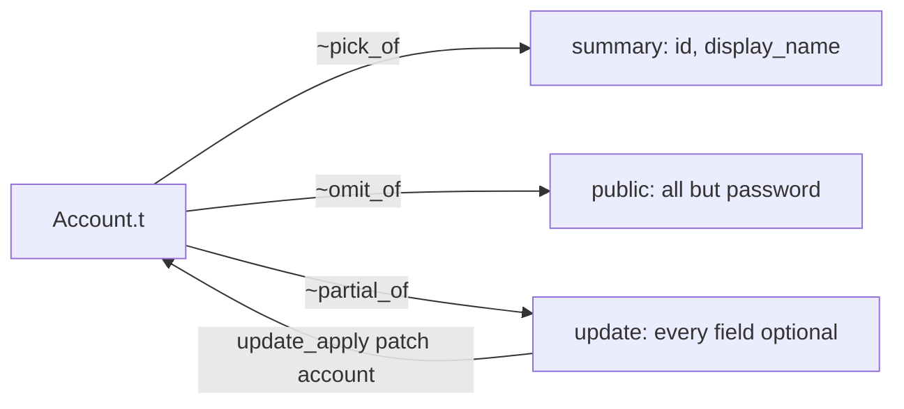
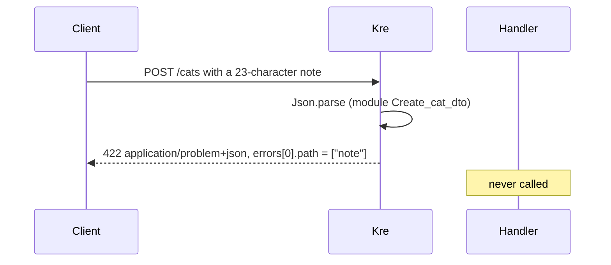

# Validation & types

<p class="lead">Kre does not validate input — it parses it. A field of type <code>Cat.Name.t</code> can only hold a name that passed its rules, so once a request reaches your handler there is nothing left to check. One attribute, <code>[@@deriving dto]</code>, gives a type its JSON codec, its JSON Schema and its rules, on the server and in the browser alike.</p>

<script setup>
const parse = [
  { title: 'Raw JSON', sub: 'Body, query or path segment as it arrived', tone: 'magma' },
  { title: 'of_json', sub: 'jsonkit decoder: shape, types, required fields', code: '[@@deriving dto]', tone: 'amber' },
  { title: 'Refined fields', sub: 'Each opaque field runs its own of_repr', code: 'Cat.Age.of_repr', tone: 'ember' },
  { title: '[@validate] rules', sub: 'All rules run; failures are collected with their paths', tone: 'violet' },
  { title: 'Typed value', sub: 'Your handler receives Create_cat_dto.t', tone: 'mint' }
]
const stats = [
  { value: '1', label: 'attribute', note: '[@@deriving dto]: codec, schema, rules' },
  { value: '2', label: 'targets', note: 'the same type compiles native and to JS' },
  { value: '422', label: 'on bad input', note: 'Problem Details with a path per field' }
]
</script>

<StatGrid :stats="stats" />

## One type, everything derived

A DTO is an ordinary record in `shared/`. The deriver rewrites `[@@deriving dto]` into jsonkit's `json` and `jsonschema` derivers, then adds Kre's own work on top: `[@validate]` rules, `~strict`, `[@exclude]`, `[@transform]` and mapped types. The result has the shape of `Kre_shared.Json.S`:

```ocaml
module type S = sig
  type t
  val of_json : Jsonkit.t -> t            (* raises on bad input *)
  val to_json : t -> Jsonkit.t
  val t_jsonschema : Jsonkit.Jsonschema.t
end
```

There is no separate `validate` function. Checking is part of decoding: after `of_json` succeeds, the value is valid. At the edge, Kre calls `Kre_shared.Json.parse (module T) json`, which turns the exception into a `(T.t, Kre_shared.Validation.t) result`.

Here is the body of `POST /cats` in the cats example:

<<< @/../examples/cats/shared/create_cat_dto.ml

Three fields are refined types from `Cat` and carry their own rules. The fourth, `note`, is a plain `string` with a one-off rule. `~strict` rejects any field the record does not declare.

<Flow :steps="parse" caption="What happens to a request body before your handler runs" />

## Refined types: make bad values unrepresentable

The best rule is one you never have to call. `Kre_shared.Refined` builds opaque types whose only constructor is a parser. A service that takes `Cat.Name.t` can never receive an empty string, because no such value exists.

<<< @/../examples/cats/shared/cat.ml{1-18 ocaml}

Each factory takes a small module of settings:

| Factory | Settings | Rule | JSON Schema |
| --- | --- | --- | --- |
| `Refined.String` | `name`, `min`, `max` | `min_length`, `max_length` | `minLength`, `maxLength` |
| `Refined.Int` | `name`, `min`, `max` | `range` | `minimum`, `maximum` |
| `Refined.Enum` | `name`, `values` | `one_of` | `enum` |
| `Refined.Email` | none | `email` | — |

Every refined module satisfies `Refined.S`: it has `of_repr` (the smart constructor, returning a `result`), `to_repr`, `pp`, and the whole `Kre_shared.Scalar.S` interface — `of_json`, `to_json`, `t_jsonschema`, `of_string` and `to_string`. That last part is why the same type works in a body, in a query string and in a path:

<<< @/../examples/cats/server/cats_controller.ml{20-24 ocaml}

`GET /cats/0` is a 404 before `find_one` is called, because `0` is not a `Cat.Id.t`. The same holds for any refined type in a path: with `~(breed : Cat.Breed.t)`, the segment `sphynx` never reaches your code. In the query string of `find_all`, `?breed=sphynx` is a 400.

### Your own refined type

When the four factories are not enough, `Refined.Make` takes a base scalar and a module of rules and schema keywords:

```ocaml
module Slug =
  Kre_shared.Refined.Make
    (Kre_shared.Scalar.String)
    (struct
      let name = "slug"

      let rules =
        Kre_shared.Validation.
          [
            min_length 3;
            rule ~name:"slug" (fun s ->
                match String.contains s ' ' with
                | false -> Ok s
                | true -> Error "must not contain spaces");
          ]

      let constraints = [ ("minLength", `Int 3) ]
    end)
```

A rule is a value of type `'a Kre_shared.Validation.rule`. The built-in ones are `min_length`, `max_length`, `min`, `max`, `range ~min ~max`, `one_of` and `email`; `Validation.rule ~name f` wraps any function of type `'a -> ('a, string) result`.

::: tip Parse once, at the edge
Refined types are the recommended path. `[@validate]` on a raw `string` or `int` is an escape hatch for one-off rules. If the same rule appears on two fields, it wants to be a type.
:::

## `[@validate]`: one-off rules on a field

Put rules on a field with `[@validate rule1; rule2]`. Every rule of every field runs, and the failures are collected rather than stopping at the first one. The shelter login form uses this for the password:

<<< @/../examples/shelter/shared/login_dto.ml

The rule names are resolved inside `Kre_shared.Validation`, so `min_length 8` needs no prefix. For a custom check, `[@validate.custom f]` takes a function `field -> (field, string) result` and reports it under the rule name `"custom"`. Here is what the deriver generates for a record with both kinds — an applicative `let+ … and+ …` that keeps the errors of every field:

```ocaml
let of_json __kre_json =
  let __kre_value = of_json __kre_json in
  Kre_shared.Validation.ok_exn
    (let open Kre_shared.Validation.Syntax in
     let+ __kre_name =
       Kre_shared.Validation.field "fullName"
         [ min_length 1; max_length 8 ] __kre_value.name
     and+ __kre_tag =
       Kre_shared.Validation.field "tag"
         [ Kre_shared.Validation.rule ~name:"custom" (fun s -> …) ]
         __kre_value.tag in
     { __kre_value with name = __kre_name; tag = __kre_tag })
```

Note the path: `"fullName"`, the JSON key, not the OCaml field name. Errors always point at what the client sent.

### Field and type options

| Attribute | Effect |
| --- | --- |
| `[@key "displayName"]` | The name of the field in JSON and in the schema |
| `[@default e]` | The field may be absent; `e` is used instead |
| `[@validate r1; r2]` | Rules, all checked, errors collected |
| `[@validate.custom f]` | A function as a rule named `custom` |
| `~strict` | Unknown fields are a 422; the schema says `additionalProperties: false` |

Nested DTOs need nothing extra: a field of type `Other.t` is decoded by `Other.of_json`, which runs its own rules.

::: warning A rule needs an expression
`[@validate]` with no payload stops the build: `Error: [@validate] expects an expression, e.g. [@validate max_length 16]`.
:::

## Ids that cannot be mixed up

Each entity gets its own id type from a generative functor:

```ocaml
module Id = Kre_shared.Id.Make ()
```

The `()` makes the functor generative: `Cat.Id.t` and `User.Id.t` are different types even though both are integers underneath, so passing a user id where a cat id is expected is a type error. `Id.S` is a `Refined.S` over `int` that only accepts values `>= 1`, plus `first`, `succ` and `equal`. Values come from parsing (JSON, path, query, a database row) or from `succ`; there is no way to build `Id.t` from an unchecked integer.

## Variants as string scalars

A refined `Enum` is a string underneath, so you cannot pattern match on it. When you want to match, write a variant of constant constructors and derive `dto`:

<<< @/../examples/shelter/shared/user.ml

The deriver turns `Role` into a full scalar: `name`, `of_string`, `to_string`, a JSON string codec and a JSON Schema `enum`. That means the type works in a path, a query, a body and a `[@column string]` in a table. The string is the constructor name in lower case; `[@key]` on a constructor picks another one:

```ocaml
type t = Available | Adopted | On_hold [@key "on hold"] [@@deriving dto]
```

That generates, among the rest:

```ocaml
let to_string = function
  | Available -> "available"
  | Adopted -> "adopted"
  | On_hold -> "on hold"

let of_string = function
  | "available" -> Ok Available
  | "adopted" -> Ok Adopted
  | "on hold" -> Ok On_hold
  | _ ->
      Error
        (Kre_shared.Validation.fail ~rule:"one_of"
           "must be one of available, adopted, on hold")
```

## Serialization: `[@exclude]` and `[@transform]`

The same record often goes both ways. `[@exclude]` accepts a field on input but drops it from every response, and marks it `writeOnly` in the schema. `[@transform f]` applies `f` to the field on output. `[@key]` renames it in JSON.

<<< @/../docs/examples/account.ml

Given the input `{"id":1,"email":"ann@x.io","password":"s3cret","displayName":"  Ann "}`, `Account.to_json` writes `{"id":1,"email":"ann@x.io","displayName":"Ann"}` — no password, and the name trimmed.

A DTO module is already a `Kre_shared.Json.S`, so a handler can simply return it (`Profile.t Lwt.t`), or you can build the response yourself:

```ocaml
let respond profile = Kre.Response.json ~status:`OK (module Profile) profile
```

## Mapped types

The last two lines of `account.ml` are mapped types. The new type is abstract in the source; the ppx expands it from a record declared in the same file.

| Option | The new type | Generated helper |
| --- | --- | --- |
| `~pick_of:(t, [ "id"; "display_name" ])` | Only the listed fields | `summary_of_t : t -> summary` |
| `~omit_of:(t, [ "password" ])` | Every field except the listed ones | `<name>_of_t : t -> <name>` |
| `~partial_of:t` | Every field as an `option`; rules apply to present fields | `update_apply : update -> t -> t` |



With the account above, `Account.summary_of_t ann` serializes to `{"id":1,"displayName":"Ann"}`, and applying the patch `{"email":"new@x.io"}` with `update_apply` changes the email and keeps the password. You declare one projection type per audience, and the compiler knows which one each handler returns.

::: warning Same file only
`~partial_of:B` where `B` is not a record of this file fails with `expected a record type of this file, e.g. ~partial_of:t`.
:::

## Time

`Kre_shared.Time.t` is an instant in UTC. It is a scalar like the others: RFC 3339 on the wire, seconds in the database. `of_seconds`, `to_seconds` and `compare` cover what the core needs; tables fill it for you with `[@created_at]` and `[@updated_at]`:

<<< @/../examples/shelter/shared/adoption.ml

## When input is wrong: 422 Problem Details

A body that is not JSON at all is a `400`. JSON that does not decode — a wrong type, a missing field, a broken rule, an unknown field under `~strict` — is a `422` in the RFC 9457 Problem Details format, with content type `application/problem+json`:

```json
{
  "type": "urn:kre:error:validation",
  "title": "Unprocessable Entity",
  "status": 422,
  "detail": "validation failed",
  "instance": "/cats",
  "errors": [
    { "path": ["note"], "rule": "max_length", "message": "must be at most 16 characters" }
  ]
}
```

Each entry of `errors` is a `Kre_shared.Validation.error`: the JSON `path` of the bad value, the `rule` that rejected it and a human `message`. Parameters fail earlier and more bluntly: a path segment that does not parse is a 404, a bad query parameter a 400.



The browser side speaks the same format. `Kre_client.Error` parses a Problem Details answer into `Problem { status; type_; title; detail; errors }`, so a form can show each message next to the field its `path` names. See [Typed client & router](/client/client-router).

Next, [Guards & auth](/guide/guards-auth) shows the same idea applied to identity: a guard does not answer yes or no, it returns the evidence.
