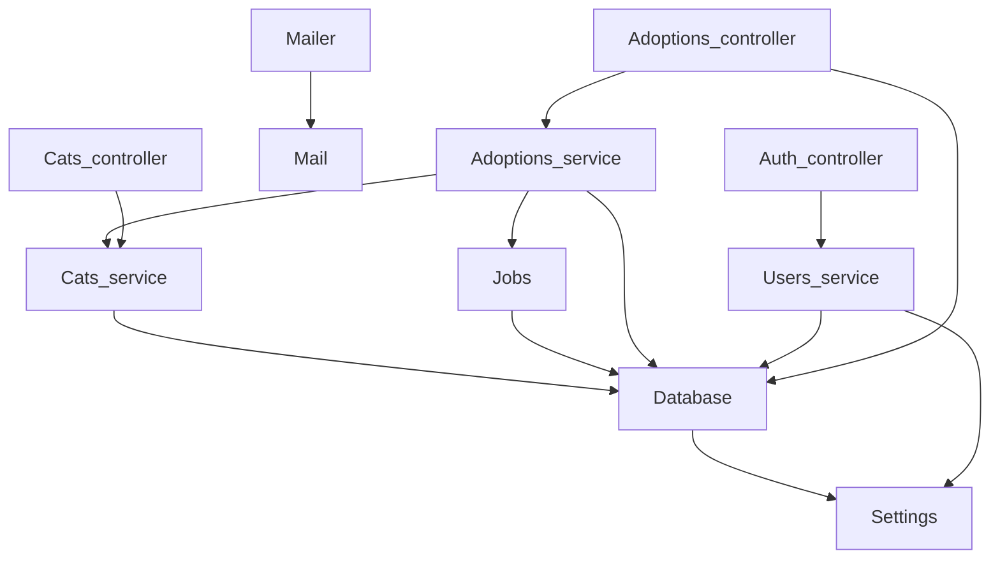
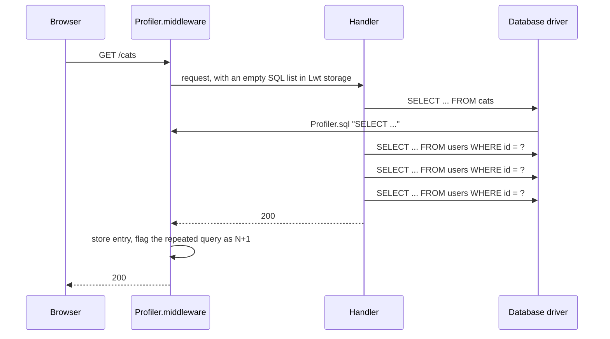

# Actuator & profiler

<p class="lead">Kre borrows two windows into a running app. The Actuator, from Spring Boot, answers health checks, metrics and "what is wired to what" in production. The Profiler, from Symfony, shows every request with its SQL in development and flags N+1 queries. Both are a controller and a middleware you add in <code>main.ml</code> — and the bean graph they show is the one the compiler built.</p>

<script setup>
const stats = [
  { value: '8', label: 'actuator endpoints', note: 'health to beans.mmd' },
  { value: '50', label: 'requests kept', note: 'by the dev profiler' },
  { value: '3+', label: 'same query in one request', note: 'flagged as N+1' }
]
const health = [
  { title: '[@@health "db"]', sub: 'On a provider function: unit -> (unit, string) result Lwt.t', tone: 'ember' },
  { title: '[%wire]', sub: 'Collects every check of the app into app.health', tone: 'amber' },
  { title: 'Actuator.make', sub: '~checks:app.health', tone: 'violet' },
  { title: 'GET /actuator/health', sub: '200 up, or 503 down with the reason', tone: 'mint' }
]
const compare = [
  { topic: 'Health checks', elsewhere: 'HealthIndicator beans (Spring); Terminus (Nest)', kre: '[@@health "name"] on any provider function' },
  { topic: 'Config dump', elsewhere: '/actuator/env with sanitizing rules', kre: '/actuator/env from Config.pairs; [@secret] fields print ***' },
  { topic: 'Metrics', elsewhere: 'Micrometer + Prometheus registry', kre: '/actuator/metrics in Prometheus text format, built in' },
  { topic: 'Dependency graph', elsewhere: '/actuator/beans at run time (Spring); Nest Devtools graph', kre: '/actuator/beans and beans.mmd, produced by [%wire] at compile time' },
  { topic: 'Request and SQL inspector', elsewhere: 'Symfony Web Profiler; Rails dev log', kre: '/__kre/profiler and profiler.json' },
  { topic: 'N+1 detection', elsewhere: 'Bullet (Rails)', kre: 'The same query 3 or more times in one request is flagged' }
]
</script>

<StatGrid :stats="stats" />

## Turning it on

This is the whole `main.ml` of the shelter app. The actuator takes the controllers, the health checks and the bean graph that `[%wire]` produced; the profiler is one middleware and one controller:

<<< @/../examples/shelter/bin/main.ml

`Kre.Actuator.make` returns a record with two parts: `controller`, the routes under `/actuator`, and `metrics`, a middleware that counts requests. Put `metrics` in the global middleware list so every route is counted.

```ocaml
val make :
  ?checks:check list ->
  ?info:(string * string) list ->
  ?env:(string * string) list ->
  ?beans:bean list ->
  ?access:access ->
  Controller.t list ->
  t
```

## Actuator endpoints

| Path | Answers |
| --- | --- |
| `/actuator/health` | Every check; `200` with `up`, or `503` with `down` and the reason |
| `/actuator/info` | The `~info` pairs: version, commit, anything you pass |
| `/actuator/env` | The configuration from `Config.pairs`; `[@secret]` values are `***` |
| `/actuator/routes` | The `spec` of every controller |
| `/actuator/openapi.json` | The OpenAPI 3.1 document |
| `/actuator/metrics` | Prometheus text: requests by method and status, time, GC |
| `/actuator/beans` | The application graph from `[%wire]`, as JSON |
| `/actuator/beans.mmd` | The same graph as a Mermaid diagram |

### Health checks

<Flow :steps="health" caption="From one attribute to a load balancer probe" />

A health check is a provider function of type `unit -> (unit, string) result Lwt.t` marked `[@@health "name"]`. The shelter's database provider pings MariaDB:

<<< @/../examples/shelter/server/database.ml{19-27 ocaml}

All checks run in parallel. If one fails, the whole answer is `503`:

```json
{ "status": "down", "checks": { "db": "down: Connection refused" } }
```

and when all pass:

```json
{ "status": "up", "checks": { "db": "up" } }
```

### Configuration, with secrets hidden

`~env:(Config.pairs Settings.config)` lists every setting under its environment variable name. Fields marked `[@secret]` in the `[@@deriving config]` record are printed as `***`:

<<< @/../examples/shelter/server/config.ml

```json
{ "INTERFACE": "127.0.0.1", "PORT": "8080", "DATABASE_URL": "***", "JWT_SECRET": "***" }
```

The same pairs are what `Config.pp` prints at startup, so the log and the endpoint never disagree.

### Metrics

`/actuator/metrics` speaks the Prometheus text format, so any scraper can read it without an exporter:

```text
kre_requests_total{method="GET",status="200"} 1284
kre_requests_total{method="POST",status="422"} 7
kre_request_seconds_sum{method="GET"} 3.481200
ocaml_gc_heap_words 1048576
ocaml_gc_major_collections 12
```

### Beans: the graph the compiler built

Spring's `/actuator/beans` reports what the container did at run time. In Kre there is no container: `[%wire]` sorts and applies the functors at compile time and stores the result in `app.beans`. The endpoint shows providers in start order, then controllers, each with what it was given — exactly what was applied, because it is the same data. `/actuator/beans.mmd` renders it as Mermaid. For the shelter it is:



Paste the output of `curl localhost:8080/actuator/beans.mmd` into any Mermaid renderer to get this picture for your own app. More on how the graph is built in [Dependency injection](/guide/dependency-injection).

### Who may read it

By default the actuator answers only requests from loopback (`127.0.0.1`, `::1`); anyone else gets a 403. That suits a sidecar or an `ssh` tunnel. To expose it — say, behind your own auth proxy — pass `~access:Anyone`:

```ocaml
type access = Loopback | Anyone
```

::: warning Think before `Anyone`
`/actuator/env` lists your configuration and `/actuator/routes` your whole API. Secrets are masked, but the rest is not.
:::

## The dev profiler

`Kre.Profiler` records every request with the SQL it ran. Add `Kre.Profiler.middleware` and `Kre.Profiler.controller`, as in the `main.ml` above, and open:

- `/__kre/profiler` — the last 50 requests: method, path, status, time, and every SQL statement in the order it ran.
- `/__kre/profiler.json` — the same as JSON, with a `repeated` list per request.



The database drivers (`kre-db-mariadb`, `kre-db-postgresql`) and `Db.query` report each statement with `Kre.Profiler.sql`, so you see the queries of sqlgg, of `Table.crud` and of the job queue alike. Each HTTP request keeps its own list in an Lwt key, so concurrent requests never mix.

### N+1, flagged

When the same SQL runs **three or more times** in one request, the profiler marks it `N+1` — like Rails' Bullet. It is almost always a loop over a service that wants to be a single `JOIN` or a `by_<column>` lookup from `Table.crud`. From code, `Kre.Profiler.repeated entry` returns those queries with their counts.

::: info Development only
The profiler is active only when `KRE_ENV` is `dev` or unset. Under any other profile the middleware does nothing and the pages answer 404, so leaving it in `main.ml` is safe.
:::

## The request log

`Dream.logger` is the first middleware in the shelter's list: one line per request with method, path, status and time, plus anything the handlers log with `Dream.log` or `Dream.info`. `Kre.Interceptor.logging` adds a line per handler with its outcome — `ok` or the error code — see [Errors & interceptors](/guide/errors).

## How it compares

<Compare :rows="compare" left="Spring / Symfony / Rails" right="Kre" />
